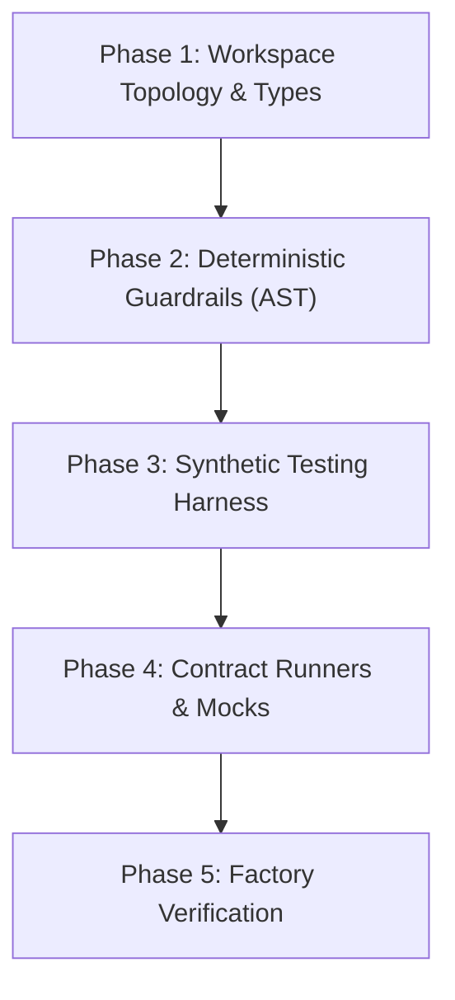

# Factory Model & Harness Engineering Skill

Use this skill whenever setting up a new repository foundation, scaffolding monorepo packages, building deterministic AST guardrails, constructing synthetic testing harnesses, or preparing the testing environment for autonomous agent implementation.

Methodology Reference: [`docs/the-new-sdlc.md`](../../docs/the-new-sdlc.md) (*The Factory Model & Harness Engineering*)  
Checklist Reference: [`docs/factory-model-setup.md`](../../docs/factory-model-setup.md)

---

## 1. Core Principles: CapEx vs. OpEx Inversion

Per the **Factory Model** framework:

$$\mathbf{Agent = Model + Harness}$$

* **The Model (~10%):** Off-the-shelf foundation reasoning engine. Never trained or modified by the developer.
* **The Harness (~90%):** The scaffolding, sandboxes, tools, deterministic linters, and synthetic test suites constructed by the developer.
* **Economic Inversion:** Invest upfront in high CapEx (harness, type contracts, contract runners) to achieve ultra-low OpEx (sustainable feature development without regression drift or context collapse).

---

## 2. The 5 Harness Scaffolding Phases

When initializing or verifying the factory floor:



### Phase 1: Workspace Topology & Shared Types
* Define monorepo package topology (e.g. `pnpm-workspace.yaml`).
* Configure TypeScript project references with `composite: true` for sub-second incremental compilation.
* Centralize domain contracts and event interfaces in `@<project>/types` before implementing any feature package.

### Phase 2: Deterministic Guardrails & AST Linters
* Never rely solely on LLM prompt obedience for hard architectural rules. Enforce via deterministic AST scripts:
  * **Zero Circular Dependencies:** Run `madge` or AST cycle checkers (`guards/no-cycles.ts`).
  * **Strict Boundary Isolation:** Block invalid cross-package imports (`guards/contract-boundary.ts`).
  * **Plain Language UX Linter:** Scan UI and user-facing CLI error strings for internal jargon (`guards/plain-language.ts`).
  * **Dead Code Eliminator:** Detect orphaned exports and dead code with Knip (`guards/unused-exports.ts`).

### Phase 3: Synthetic Testing Harness
* Implement scenario builders (e.g., `ScenarioBuilder`) with seeded pseudorandom generators and mock clocks.
* **Privacy Boundary:** Never use real user data, credentials, or customer PII in fixtures. Generate synthetic streams.
* Include fault-injection capabilities: process crashes, SQLite busy/locked states, transient network disconnections.

### Phase 4: Parameterized Contract Runners & Mock Servers
* Build reusable contract test suites (`describeSourceContract`, `describeSinkContract`) that can be executed against any adapter implementation.
* Build local mock servers for third-party HTTP/WebSocket APIs (e.g., `MockMarginceServer` with HMAC-SHA256 signature verification).

### Phase 5: Factory Self-Verification Run
Execute the complete verification pipeline before writing any production feature code:
```bash
pnpm clean && pnpm build && pnpm guard && pnpm test
```
All packages must compile with zero warnings, all guards pass, and Vitest suite completes in under 2 seconds.

---

## 3. Operational Story Execution Runbook

Once the factory floor is verified, execute user stories using the **6-Step Orchestrator <-> Agent Lifecycle**:

1. **Story Trigger & Plan:** Developer specifies story ID (e.g., `US-S1-01`). Agent loads BDD scenarios and relevant ADRs, then outlines an implementation plan.
2. **Red Phase (Test First):** Agent authors Vitest assertions and verifies failure (`Red`) using synthetic fixtures.
3. **Green Phase & Self-Healing:** Agent writes minimal code. If tests or compiler fail, agent diagnoses stack traces and patches code autonomously.
4. **Guard Phase:** Agent runs `pnpm guard` to verify AST rules, contract boundaries, and zero jargon.
5. **Adversarial Review Phase:** Agent conducts an isolated review of the diff against acceptance criteria, ADR compliance, error paths, and edge cases.
6. **Sign-Off:** Agent marks story checkbox done in backlog and presents clean diff and audit summary for developer review and approval.

