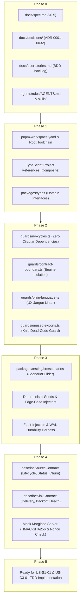
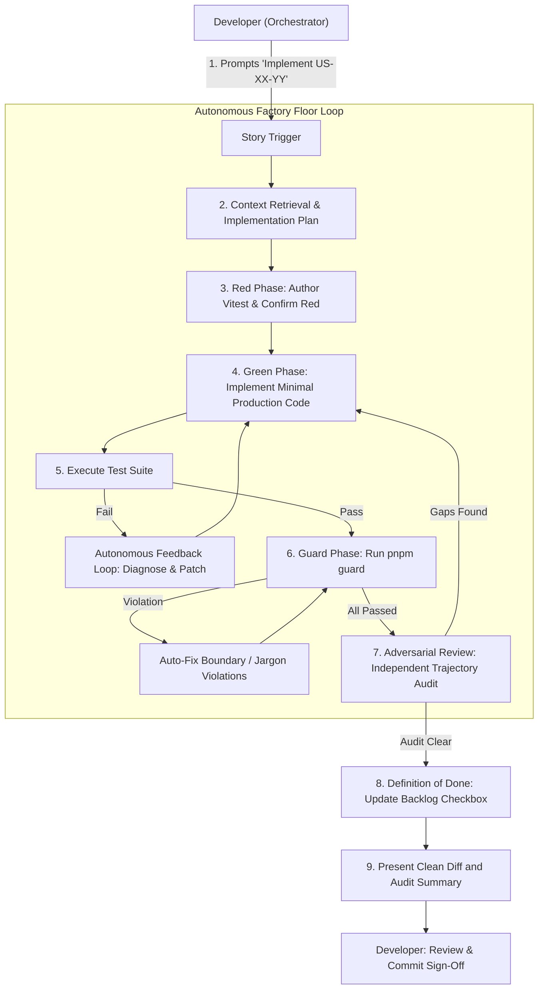

# Chat Bridge: Factory Model & Harness Engineering Setup Checklist

**Document Version:** 1.0  
**Target Milestone:** Sprint 0 / Foundation Setup (Pre-Sprint 1 Enablement)  
**Primary Persona:** Dylan (Software Engineer / Intern)  
**Methodology Reference:** [`docs/the-new-sdlc.md`](the-new-sdlc.md) (*The Factory Model & Harness Engineering*)  
**Architectural Decisions:** [ADR 0015](decisions/0015-monorepo-topology-workspace-boundaries-contract-guards.md), [ADR 0018](decisions/0018-testing-harness-scenario-contract-runner.md), [ADR 0008](decisions/0008-margince-push-protocol-hmac-mock.md)

---

## Executive Summary

Per the **Factory Model** framework ([`docs/the-new-sdlc.md`](the-new-sdlc.md#6-the-factory-model-building-the-system-that-builds-software)), our primary engineering output is not raw code: it is the **system that produces and verifies code**:

$$\mathbf{Agent = Model + Harness}$$

Before implementing product features in Sprint 1 (`US-S1-01` through `US-K4-01`), we make the upfront **CapEx investment** in the Harness. This scaffolding provides the constraints, sandboxes, linters, and synthetic contract runners that enable rapid, low-OpEx implementation with zero regression drift.



---

## Phase 0: Intent, Architecture & Context Engineering (Completed)

*Status: **Verified Complete***

- [x] **0.1 Product Specification:** Authored and baselined [`docs/spec.md`](spec.md) (v0.5) with core contracts, invariants, and privacy boundaries.
- [x] **0.2 Architecture Decision Records:** Documented and accepted 32 ADRs in [`docs/decisions/`](decisions/) providing 100% architectural coverage.
- [x] **0.3 Persona-Grounded Backlog:** Authored [`docs/user-stories.md`](user-stories.md) covering Epics 1–10 with BDD Gherkin acceptance criteria.
- [x] **0.4 Static Context Invariants:** Configured [`.agents/rules/AGENTS.md`](../.agents/rules/AGENTS.md) (zero PII, TDD mandate, plain language guard).
- [x] **0.5 Dynamic Context Skills:** Configured `.agents/skills/` (`chat-bridge-dev`, `architecture-decision`, `user-story-authoring`, `agentic-sdlc`).

---

## Phase 1: Workspace Topology & Monorepo Infrastructure

*Target:* Establish strict package boundaries and dependency inversion per [ADR 0015](decisions/0015-monorepo-topology-workspace-boundaries-contract-guards.md).

- [x] **1.1 Workspace Configuration:**
  - Create `pnpm-workspace.yaml` defining:
    ```yaml
    packages:
      - 'packages/*'
      - 'packages/sources/*'
      - 'packages/sinks/*'
    ```
  - Create root `package.json` with unified development scripts:
    * `pnpm build`: Incremental TypeScript compilation across all packages.
    * `pnpm test`: Runs Vitest across all workspace packages.
    * `pnpm test:unit`: Fast inner-loop unit tests (<1s).
    * `pnpm guard`: Runs all deterministic boundary and quality linters.
    * `pnpm clean`: Cleans build caches and dist artifacts.

- [x] **1.2 Monorepo TypeScript Configuration:**
  - Root `tsconfig.base.json` with strict type checking (`strict: true`, `noImplicitAny: true`, `exactOptionalPropertyTypes: true`).
  - Configure TypeScript Composite Projects (`"composite": true`) and Project References (`references: [...]`) across packages to ensure instant incremental type-checking.

- [x] **1.3 Core Domain Package (`packages/types`):**
  - Package Name: `@chat-bridge/types`
  - **Inviolable Invariant:** Zero external runtime dependencies.
  - Define canonical domain interfaces per [Section 5 & 6 of `docs/spec.md`](spec.md#L102-L147):
    * `Message`, `Thread`, `Contact`, `AttachmentPlaceholder`.
    * `SourceContract`: `login()`, `start()`, `stop()`, `status()`, `chats()`, `history()`, `send()`.
    * `SinkContract`: `configure()`, `test()`, `deliver()`, `health()`, `limits()`, `pullReplies()`, `ack()`.
    * Core enums: `ConnectorStatus`, `SinkHealth`, `MessageDropReason`.

---

## Phase 2: Deterministic Guardrails & AST Linters

*Target:* Automate quality gates that execute before code review, enforcing [Section 14 of `docs/spec.md`](spec.md#L351-L358).

- [x] **2.1 Circular Dependency Guard (`guards/no-cycles.ts`):**
  - Uses graph-based import dependency analysis to scan imports across all workspace packages.
  - Fails build immediately (exit code 1) if any circular dependency is detected.
  - Hooked into `pnpm guard`.

- [x] **2.2 Contract Boundary Linter (`guards/contract-boundary.ts`):**
  - Scans TypeScript imports across workspace packages.
  - Asserts that `packages/engine` contains **zero** imports from concrete sources (`@chat-bridge/source-*`) or sinks (`@chat-bridge/sink-*`).
  - Asserts that no source imports any sink, and no sink imports any source.
  - Asserts `@chat-bridge/types` has zero runtime external dependencies.

- [x] **2.3 Plain-Language UI Linter (`guards/plain-language.ts`):**
  - Scans user-facing string literals, JSX, and i18n dictionaries in `packages/ui` and `packages/i18n`.
  - Blocklist flags: `"sink"`, `"outbox"`, `"JID"`, `"regex"`, `"daemon"`, `"payload"`, `"stdout"`.
  - Generates clear remediation tips pointing to the plain-language lexicon ([ADR 0007](decisions/0007-frontend-stack-plain-language-guard.md) and [ADR 0027](decisions/0027-internationalization-plain-language-lexicon-bilingual-parity.md)).

- [x] **2.4 Secret & Zero-PII Sanitization Hook (`guards/secret-scan.ts`):**
  - Scans staged files and test fixtures for live API tokens, real phone numbers, or private keys.

---

## Phase 3: Synthetic Testing Harness & Scenario Engine

*Target:* Deliver deterministic, 100% PII-free simulation tooling for Dylan per [ADR 0018](decisions/0018-testing-harness-scenario-contract-runner.md).

- [x] **3.1 ScenarioBuilder Framework (`packages/testing/src/scenarios/`):**
  - Fluent, programmatic generator for synthetic message streams with deterministic seed support:
    ```typescript
    const scenario = new ScenarioBuilder({ seed: 42 })
      .withContacts(10)
      .withOtpCode('123456')
      .withLongText(40000) // Truncation test
      .withNoise(['reaction', 'typing', 'story'])
      .withLidMapping('+1234567890', 'user-lid-999')
      .build();
    ```

- [x] **3.2 Fault-Injection & Network Resilience Simulators (`packages/testing/src/harness/`):**
  - `SimulatedNetwork`: Programmable latency, intermittent drops, HTTP 429 rate limits, and 503 service unavailable responses.

---

## Phase 4: Parameterized Contract Runners & Mock Servers

*Target:* Provide reusable contract test suites guaranteeing 100% behavioral parity per [ADR 0018](decisions/0018-testing-harness-scenario-contract-runner.md) and [ADR 0008](decisions/0008-margince-push-protocol-hmac-mock.md).

- [x] **4.1 Parameterized Source Contract Runner (`describeSourceContract`):**
  - Test suite validating any `SourceContract` implementation:
    * Lifecycle: Idempotent `start()` and `stop()`.
    * Status: Deterministic transitions (`connected`, `needs-login`, `taken-over`, `error`).
    * Discovery: Proper `chats()` formatting, thread kind tags (`direct` vs `group`).
    * Send: Input validation, error propagation, and message echo handling.

- [x] **4.2 Parameterized Sink Contract Runner (`describeSinkContract`):**
  - Test suite validating any `SinkContract` implementation:
    * Delivery: Batch processing, returning granular outcomes (`accepted`, `duplicate`, `refused`).
    * Rate Limits: Respects declared `limits` object, backs off correctly on 429 retry headers.
    * Health: Accurately reports `ok`, `degraded`, or `down`.

- [x] **4.3 Local Mock Margince Server (`packages/testing/src/mocks/margince-server.ts`):**
  - Fast in-memory & loopback HTTP server implementing the Margince Push/Pull API:
    * Validates HMAC-SHA256 signatures (`X-Bridge-Signature`) against test shared secret.
    * Rejects replayed timestamps/nonces outside the 5-minute tolerance window.
    * Provides programmable responses: instant 200, temporary 429 with `Retry-After`, and persistent 500.
    * Exposes `getReceivedMessages()` and `reset()` helpers for deterministic TDD assertions.

---

## Phase 5: Factory Verification & Sprint 1 Handoff

*Target:* Prove the Factory Floor works before writing a single line of production engine code.

- [x] **5.1 Factory Self-Verification Run:**
  - Executed:
    ```bash
    pnpm clean && pnpm build && pnpm guard && pnpm test
    ```
  - Assertions Verified:
    * TypeScript compilation across all workspace packages completes with zero warnings.
    * All 4 guard scripts pass.
    * `describeSinkContract` and `describeSourceContract` pass against providers.
    * Vitest execution time remains under 1 second (30 tests in ~950ms).

- [x] **5.2 Sprint 1 Green Light:**
  - Ready for **`US-S1-01`** (Fake Source & Mock Margince Harness) and **`US-C3-01`** (Encrypted Outbox SQLite WAL) implementation.

---

## Summary of Dylan's Verification Commands

| Command | Purpose | Success Criteria |
| :--- | :--- | :--- |
| `pnpm build` | Incremental monorepo compilation | Zero type errors, exit code 0 |
| `pnpm guard` | Run architectural AST & plain-language linters | Zero circular dependencies, zero contract leaks, zero banned words |
| `pnpm test` | Execute complete test suite | All unit, contract, and scenario tests pass |
| `pnpm test:watch` | Inner-loop TDD runner during coding | Sub-second reaction to file edits |

---

## Operational Runbook: Executing a User Story via the Factory

This section defines the end-to-end execution lifecycle when Dylan (or any developer) picks up a user story from [`docs/user-stories.md`](user-stories.md).

### 1. Developer-Agent Collaboration Flow

The Factory Model operates as a **semi-automated, governed assembly line**. The developer acts as the **Orchestrator** (setting intent, reviewing plans, and approving outcomes), while the AI agent acts as the **Factory Worker** (scoping plans, writing code, executing tests, self-healing against automated quality gates, and undergoing an adversarial review).



### 2. The 6-Step Story Lifecycle

#### Step 1: Intent, Context Loading & Implementation Plan (Developer -> Agent)
* **Trigger:** Developer instructs: *"Implement `US-S1-01` (Fake Source & Mock Margince Harness)"*.
* **Autonomous Context Loading:** The agent reads:
  1. The BDD Gherkin scenario from [`docs/user-stories.md`](user-stories.md).
  2. Architectural requirements from related ADRs (e.g., [`docs/decisions/0018-testing-harness-scenario-contract-runner.md`](decisions/0018-testing-harness-scenario-contract-runner.md)).
  3. Boundary and privacy invariants from [`.agents/rules/AGENTS.md`](../.agents/rules/AGENTS.md).
* **Pre-Execution Plan:** For complex stories, the agent outlines affected files, contract signatures, synthetic test cases, and edge case boundaries before modifying production code.

#### Step 2: Red Phase: Test First (Agent Autonomy)
* The agent authors unit or contract tests under `packages/<package>/tests/` matching the Gherkin `Given / When / Then` assertions.
* Uses only synthetic test data (`ScenarioBuilder`, `FakeSource`, `MockMarginceServer`). Never live credentials or real phone numbers.
* Runs the test command (e.g. `pnpm --filter @chat-bridge/<pkg> test`).
* **Verification:** Confirms the test executes and **fails as expected** (Red).

#### Step 3: Green Phase & Autonomous Feedback Loop (Agent Autonomy)
* The agent writes the minimal implementation code in `packages/<package>/src/`.
* Re-executes the test suite.
* **Autonomous Feedback Loop (Self-Healing):** If tests fail, TypeScript compilation errors occur, or assertions mismatch:
  1. The agent parses the compiler errors and stack traces.
  2. The agent diagnoses the root cause.
  3. The agent patches the code and re-runs the test runner.
  *This iteration runs autonomously without asking the human developer to debug syntax.*

#### Step 4: Quality Gate Verification (Agent Autonomy)
* Once tests pass, the agent executes the monorepo guard suite:
  ```bash
  pnpm guard
  ```
* Enforces four deterministic gates:
  1. **Circular Dependencies:** Zero cycles detected by `guards/no-cycles.ts`.
  2. **Boundary Isolation:** `guards/contract-boundary.ts` ensures Sources and Sinks do not leak or cross-import.
  3. **UX Jargon Guard:** `guards/plain-language.ts` ensures no banned words (`sink`, `outbox`, `JID`, `regex`) appear in user-facing surfaces.
  4. **Dead Code:** `guards/unused-exports.ts` confirms no dangling or unused exports.

#### Step 5: Adversarial Audit & Trajectory Review (Isolated Verification)
* The implementation is audited against potential blind spots and edge cases:
  1. **Acceptance Verification:** Verifies all Gherkin clauses in [`docs/user-stories.md`](user-stories.md) are strictly covered.
  2. **Architectural Alignment:** Confirms no drift against accepted ADR patterns in [`docs/decisions/`](decisions/).
  3. **The 20% Edge Cases:** Checks transient network handling, error logging without PII, rate-limiting, and resource cleanup.
  *If gaps are discovered, the agent patches them before requesting developer sign-off.*

#### Step 6: Definition of Done & Human Sign-Off (Agent -> Developer)
* The agent updates the story checkbox (`- [x]`) in [`docs/user-stories.md`](user-stories.md).
* The agent presents a concise diff summary:
  * Files created / modified.
  * Test execution log verifying Green.
  * Guard verification log verifying zero violations.
  * Adversarial audit confirmation.
* **Human Checkpoint:** The developer reviews the final diff and approves the commit.

---

### 3. Responsibility Matrix: Automation vs. Human Control

| Lifecycle Phase | Autonomous (Agent & Harness) | Human Control (Developer / Dylan) |
| :--- | :--- | :--- |
| **Story Selection** | None | Selects target story from backlog based on sprint priority |
| **Context & Plan** | Reads BDD scenarios and ADRs; formulates implementation plan | Reviews and steers plan for high-complexity architectural stories |
| **Test Authoring (Red)** | Generates Vitest assertions from Gherkin specifications | Reviews test coverage strategy if architecture changes |
| **Implementation (Green)**| Writes minimal production TypeScript code | Steers trade-offs if multiple implementation paths exist |
| **Self-Healing** | Parses error traces, diagnoses bugs, and iterates code | Steps in only if an external spec flaw is discovered |
| **Quality Gates** | Runs AST linters, cycle detectors, and plain language guards | Configures project tolerances and rule definitions |
| **Adversarial Audit** | Evaluates diff against edge cases, ADRs, and acceptance criteria | Validates audit findings and assesses business risk |
| **Final Sign-Off** | Marks backlog checklist done, formats clean diff summary | Reviews code changes, approves, and commits |


