# The Practical Test Pyramid: A Comprehensive Guide to Balanced Test Automation

**Author:** Ham Vocke (Thoughtworks)  
**Publication:** Martin Fowler's Bliki (*martinfowler.com*)  
**Original Publication Date:** 26 February 2018  
**Source Document:** `The Practical Test Pyramid.html`  
**Curator & Reviewer:** Martin Fowler  
**Chat Bridge Reference:** Foundational engineering guide for multi-layered testing, harness construction, contract validation, and anti-duplication governance.

---

## Executive Summary & Quick Reference

The **Test Pyramid** is an essential architectural metaphor coined by Mike Cohn and refined by Ham Vocke. It guides engineering teams to group software tests into buckets of different granularity and balance the volume of tests across those layers:

$$\text{Test Volume} \propto \frac{1}{\text{Execution Cost} \times \text{Execution Time}}$$

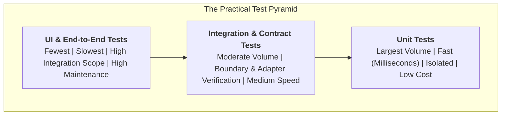

### Layer Comparison Matrix

| Layer | Primary Focus | Collaborators | Execution Speed | Typical Tooling | Failure Root-Cause Locality |
| :--- | :--- | :--- | :--- | :--- | :--- |
| **Unit Tests** | Single unit (function, class, module) observable behavior | Test doubles (solitary) or lightweight real domain objects (sociable) | Milliseconds (< 1 ms per test) | JUnit 5, Vitest, Mockito, Jest | **Immediate:** Pinpoints exact line or logic condition |
| **Integration Tests** | Boundaries with external components (DB, filesystem, network) | Real or containerized DB, WireMock, MSW | Seconds (100 ms – 2 s) | Spring `@DataJpaTest`, WireMock, Testcontainers | **Boundary:** Pinpoints SQL mapping, serialization, HTTP handshake |
| **Contract Tests** | Inter-service interface agreements (Consumer-Driven Contracts) | Mock Provider / Pact replay runner | Fast to moderate (< 500 ms) | Pact (JVM/JS), Spring Cloud Contract | **Interface:** Detects schema divergence or semantic field mismatch |
| **UI Tests** | User interface state transitions, event handling, visual layout | Stubbed backend APIs / Headless DOM | Seconds (1 s – 5 s) | Jest, Testing Library, Playwright Component, Galen | **Presentation:** Pinpoints component rendering, input binding |
| **End-to-End Tests** | Entire integrated software stack from user interface to DB | All real integrated services | Minutes (30 s – 5 min) | Selenium WebDriver, Playwright, REST-Assured | **Systemic:** Proves release readiness; high debugging cost |
| **Exploratory Testing** | Edge cases, UX usability, visual polish, chaos | Human investigator with timeboxed charters | Manual / On-Demand | Exploratory Charters, Session-Based Test Management | **Experiential:** Uncovers unscripted edge cases and cognitive friction |

---

## Table of Contents

1. [The Importance of (Test) Automation](#1-the-importance-of-test-automation)
2. [The Test Pyramid Metaphor Revisited](#2-the-test-pyramid-metaphor-revisited)
3. [The Sample Application Architecture](#3-the-sample-application-architecture)
4. [Unit Tests: The Foundation](#4-unit-tests-the-foundation)
   - [What is a Unit?](#what-is-a-unit)
   - [Sociable vs. Solitary Unit Tests](#sociable-vs-solitary-unit-tests)
   - [The Test Double Taxonomy: Mocks, Stubs, and Fakes](#the-test-double-taxonomy-mocks-stubs-and-fakes)
   - [Sidebar: The "Private Method" Code Smell](#sidebar-the-private-method-code-smell)
   - [What to Test: Observable Behavior vs. Implementation Details](#what-to-test-observable-behavior-vs-implementation-details)
   - [Test Structure: Arrange-Act-Assert / Given-When-Then](#test-structure-arrange-act-assert--given-when-then)
   - [Sidebar: Specialized Test Helpers & MockMVC](#sidebar-specialized-test-helpers--mockmvc)
   - [Unit Test Implementation Deep Dive](#unit-test-implementation-deep-dive)
5. [Integration Tests: Verifying Boundaries](#5-integration-tests-verifying-boundaries)
   - [Narrow vs. Broad Integration Testing](#narrow-vs-broad-integration-testing)
   - [Database Integration Testing](#database-integration-testing)
   - [External HTTP Service Integration (WireMock)](#external-http-service-integration-wiremock)
6. [Contract Tests: Consumer-Driven Contracts (CDC)](#6-contract-tests-consumer-driven-contracts-cdc)
   - [The Fallacy of "Over-the-Fence" Interface Specifications](#the-fallacy-of-over-the-fence-interface-specifications)
   - [Consumer Test Execution & Pact File Generation](#consumer-test-execution--pact-file-generation)
   - [Provider Verification Execution](#provider-verification-execution)
7. [UI Tests: Separating Behavior, Layout, and Usability](#7-ui-tests-separating-behavior-layout-and-usability)
   - [Component-Level UI Tests](#component-level-ui-tests)
   - [Visual Regression & Layout Testing](#visual-regression--layout-testing)
8. [End-to-End Tests: The Broad Stack Safety Net](#8-end-to-end-tests-the-broad-stack-safety-net)
   - [UI-Driven End-to-End Tests](#ui-driven-end-to-end-tests)
   - [REST API-Driven End-to-End Tests](#rest-api-driven-end-to-end-tests)
   - [The True Cost and Flakiness of E2E Suites](#the-true-cost-and-flakiness-of-e2e-suites)
9. [Acceptance Tests & Living Documentation](#9-acceptance-tests--living-documentation)
10. [Exploratory Testing: Complementing Automation](#10-exploratory-testing-complementing-automation)
11. [Demystifying Testing Terminology](#11-demystifying-testing-terminology)
12. [Pipeline Integration: Speed and Scope as Organizing Principles](#12-pipeline-integration-speed-and-scope-as-organizing-principles)
13. [Avoiding Test Duplication: Pruning the Iceberg](#13-avoiding-test-duplication-pruning-the-iceberg)
14. [Writing Clean Test Code](#14-writing-clean-test-code)
15. [Direct Mapping to Chat Bridge Architecture](#15-direct-mapping-to-chat-bridge-architecture)
16. [Acknowledgements & Source References](#16-acknowledgements--source-references)

---

## 1. The Importance of (Test) Automation

Software has outgrown its early sole purpose of automating back-office processes; modern businesses rely on digital software as their primary competitive differentiator. Rapid iteration requires continuous delivery: the ability to reliably release software into production at any given moment.

Manual testing—deploying an application to a staging environment, clicking buttons, and checking database records by hand—collapses under modern release frequencies. As software scales, manual testing either consumes all engineering capacity or leads to catastrophic production regressions.

Automation across build, test, and deployment pipelines is the only scalable solution:

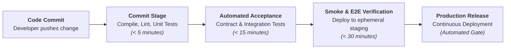

Build pipelines guarantee reproducible validation. Every commit triggers automated verification that gives developers immediate feedback if a regression is introduced.

---

## 2. The Test Pyramid Metaphor Revisited

Mike Cohn introduced the **Test Pyramid** in his book *Succeeding with Agile* (2009). The pyramid provides two fundamental rules of thumb:
1. **Write tests with different granularity:** Do not rely on a single testing mechanism.
2. **The higher the level, the fewer tests you should have:** Invert test volume relative to execution cost and duration.

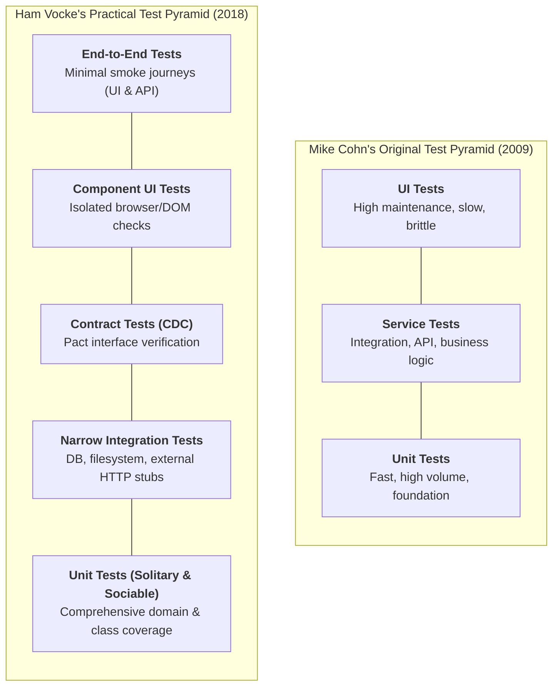

### Criticisms and Refinements of the Original Model

While Cohn's visual metaphor is intuitive, it suffers from several ambiguities:
- **Oversimplification:** The three layers (Unit, Service, UI) do not distinguish between in-process component tests, external contract tests, visual regression checks, and broad-stack end-to-end tests.
- **Terminology Confusion:** "Service tests" conflates business logic testing with HTTP integration and inter-process RPC verification.
- **UI Conflation:** Cohn's model treats UI tests and End-to-End tests as synonymous. In reality, testing a UI component can be performed in isolation at the unit level without touching a backend.

The practical test pyramid refines these tiers into distinct technical categories organized strictly by **speed, scope, and isolation**.

---

## 3. The Sample Application Architecture

To demonstrate each layer concretely, Vocke uses a Spring Boot microservice with typical distributed enterprise characteristics:

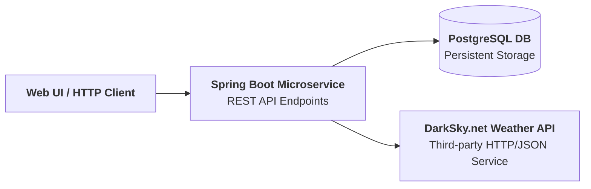

### High-Level Endpoints
1. `GET /hello/{lastName}`: Looks up a person by last name in the local database and returns `"Hello {firstName} {lastName}!"`. If not found, returns `"Who is this '{lastName}' you're talking about?"`.
2. `GET /weather`: Queries an external REST weather provider (DarkSky.net) and returns current conditions.

### Internal Microservice Architecture

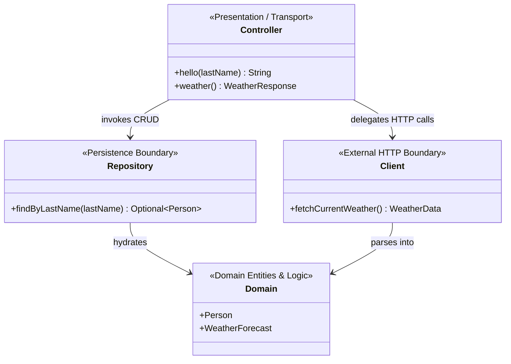

### Architectural Note: The Missing Service Layer
Experienced developers often introduce a dedicated `Service` class between `Controller` and `Repository`. In simple applications, this introduces unnecessary indirection. Furthermore, overusing service classes often leads to an **Anemic Domain Model**, where domain entities are reduced to dumb data structures while all behavior is hoarded in procedural service classes. Domain-Driven Design (DDD) dictates placing business rules within the domain models themselves.

---

## 4. Unit Tests: The Foundation

Unit tests constitute the base of the pyramid. They verify that a small, isolated unit of code (the **Subject Under Test**, or SUT) functions exactly as designed.

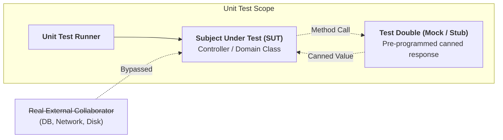

### What is a Unit?
The definition of a "unit" depends on programming paradigm:
- **Functional Languages:** A unit is typically a pure function. Tests supply arguments and assert return values.
- **Object-Oriented Languages:** A unit ranges from a single method to an entire class or a cohesive cluster of collaborating classes.

### Sociable vs. Solitary Unit Tests

Jay Fields (*Working Effectively with Unit Tests*) codified the two competing unit testing schools:

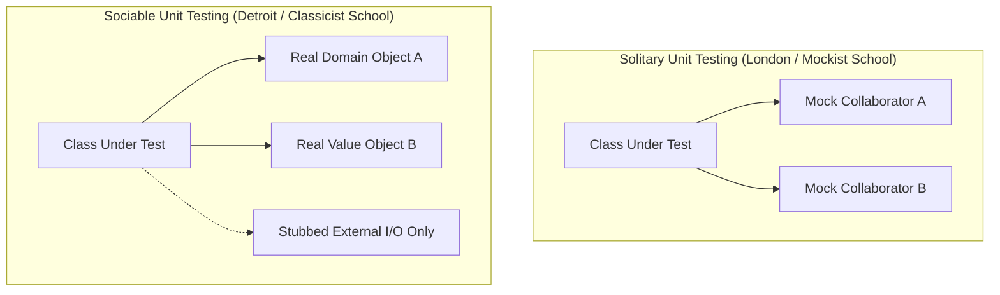

- **Solitary Unit Tests:** Every collaborator is replaced with a mock or stub. Benefits: strict isolation, immediate failure localization, zero risk of cascading failures. Drawback: heavy mocking setup; tests can be tightly coupled to internal implementation details.
- **Sociable Unit Tests:** Real domain objects and helpers are instantiated alongside the SUT; only slow, stateful, or external boundaries (databases, HTTP, disk) are stubbed out. Benefits: tests test realistic behavior and survive refactorings.

> **Operational Heuristic:** Do not treat solitary vs. sociable as a dogma. Use sociable tests for pure domain objects and business logic where collaborators are fast and deterministic. Use solitary tests when collaborating classes involve complex setup or asynchronous lifecycles.

### The Test Double Taxonomy: Mocks, Stubs, and Fakes

Gerard Meszaros (*xUnit Test Patterns*) classified test doubles into five distinct categories:

| Double Type | Definition & Operational Mechanism | Example Usage |
| :--- | :--- | :--- |
| **Dummy** | Passed around to satisfy parameter signatures, but never actually invoked or inspected. | Passing an empty `new Person("unused", "unused")` into a method. |
| **Stub** | Provides pre-programmed canned answers to method calls made during the test. | `given(repo.findByLastName("Pan")).willReturn(Optional.of(peter))` |
| **Spy** | Wraps a real object or stub to record runtime invocation details (call count, parameters) for later assertion. | Verifying that `logger.warn(...)` was called with the expected exception string. |
| **Mock** | Pre-programmed with expectations regarding which calls it must receive, failing the test if unexpected calls occur. | Strict Mockito verification: `verify(repo, times(1)).save(peter)` |
| **Fake** | Working implementation with a shortcut that makes it unsuitable for production (in-memory hash map instead of SQL). | `InMemoryPersonRepository` implementing `PersonRepository`. |

---

### Sidebar: The "Private Method" Code Smell

> [!WARNING] The Urgent Desire to Test Private Methods
> If you find yourself desperately wanting to test a `private` method, stop and recognize that this is a **design problem, not a scoping problem**.
>
> When a private method becomes so complex that testing it through the public interface requires labyrinthine setup, the class is violating the **Single Responsibility Principle (SRP)**. It is doing too much.
>
> **The Solution:**
> 1. Extract the private method and its related state into a new, dedicated class.
> 2. Make the extracted method `public` on that new class.
> 3. Inject the new class into the original class as a collaborator.
> 4. Test the new class thoroughly through its public interface.

---

### What to Test: Observable Behavior vs. Implementation Details

A common failure mode in unit testing is testing internal implementation rather than externally observable behavior:

$$\mathbf{Correct:} \quad f(x, y) \implies z$$
$$\mathbf{Incorrect:} \quad f(x, y) \implies \text{assert } \text{ClassA.step1()} \to \text{ClassB.step2()}$$

When tests verify the exact sequence of internal private method calls, any refactoring breaks the test suite even if the output behavior is identical. Tests must act as a **safety net for refactoring**, not an obstacle to it.

Avoid testing:
- Getters, setters, and plain field initializers without logic.
- Framework internal annotations and wiring in unit tests.
- Trivial pass-through methods that merely delegate without transformation.

---

### Test Structure: Arrange-Act-Assert / Given-When-Then

Every unit test must adhere to a standardized three-phase structure:

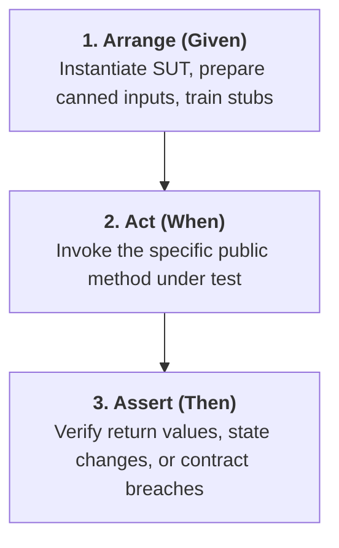

Applying this discipline keeps tests concise, self-contained, and easily readable by other developers.

---

### Sidebar: Specialized Test Helpers & MockMVC

> [!TIP] Specialized Test Helpers
> In web frameworks (such as Spring MVC, Express, or Fastify), controllers rely heavily on routing decorators, HTTP parameter bindings, and JSON serialization. Simply instantiating a controller class as a plain unit test misses route binding bugs.
>
> Specialized test harnesses (such as Spring's `MockMvc` or Supertest in Node.js) provide a lightweight in-process mock server DSL. They test routing, HTTP verb constraints, and serialization without spinning up a live network port.

---

### Unit Test Implementation Deep Dive

#### Production Controller Under Test (`ExampleController.java`)

```java
@RestController
public class ExampleController {

    private final PersonRepository personRepo;

    @Autowired
    public ExampleController(final PersonRepository personRepo) {
        this.personRepo = personRepo;
    }

    @GetMapping("/hello/{lastName}")
    public String hello(@PathVariable final String lastName) {
        Optional<Person> foundPerson = personRepo.findByLastName(lastName);

        return foundPerson
                .map(person -> String.format("Hello %s %s!",
                        person.getFirstName(),
                        person.getLastName()))
                .orElse(String.format("Who is this '%s' you're talking about?",
                        lastName));
    }
}
```

#### Solitary Unit Test Suite (`ExampleControllerTest.java`)

```java
public class ExampleControllerTest {

    private ExampleController subject;

    @Mock
    private PersonRepository personRepo;

    @Before
    public void setUp() throws Exception {
        MockitoAnnotations.initMocks(this);
        subject = new ExampleController(personRepo);
    }

    @Test
    public void shouldReturnFullNameOfAPerson() throws Exception {
        // Arrange (Given)
        Person peter = new Person("Peter", "Pan");
        given(personRepo.findByLastName("Pan"))
            .willReturn(Optional.of(peter));

        // Act (When)
        String greeting = subject.hello("Pan");

        // Assert (Then)
        assertThat(greeting, is("Hello Peter Pan!"));
    }

    @Test
    public void shouldTellIfPersonIsUnknown() throws Exception {
        // Arrange (Given)
        given(personRepo.findByLastName(anyString()))
            .willReturn(Optional.empty());

        // Act (When)
        String greeting = subject.hello("Pan");

        // Assert (Then)
        assertThat(greeting, is("Who is this 'Pan' you're talking about?"));
    }
}
```

---

## 5. Integration Tests: Verifying Boundaries

All non-trivial applications interact with external subsystems: databases, disk filesystems, message queues, and remote HTTP APIs. Unit tests stub out these boundaries for speed and isolation; **Integration Tests** verify that the code successfully interfaces with these external systems.

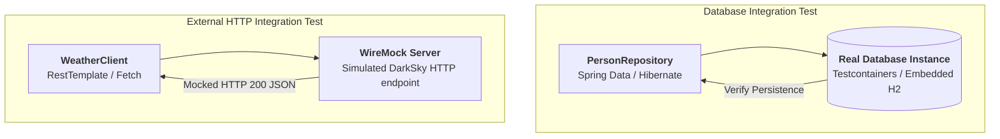

### Narrow vs. Broad Integration Testing
- **Broad Integration Testing:** Spinning up all services, databases, and dependencies simultaneously and testing end-to-end paths across services. Broad integration tests are slow, brittle, and difficult to debug.
- **Narrow Integration Testing:** Testing exactly **one integration boundary at a time**. The application code talks to a real database instance or a dedicated HTTP stub server (WireMock), keeping the scope isolated and execution fast.

### Database Integration Testing

A database integration test verifies:
1. Object-relational mapping (ORM) annotations and SQL syntax correctness.
2. Schema constraints (foreign keys, nullability, unique indexes).
3. Liquibase / Flyway migration script integrity.

#### Database Test Code (`PersonRepositoryIntegrationTest.java`)

```java
@RunWith(SpringRunner.class)
@DataJpaTest
public class PersonRepositoryIntegrationTest {

    @Autowired
    private PersonRepository subject;

    @After
    public void tearDown() throws Exception {
        subject.deleteAll();
    }

    @Test
    public void shouldSaveAndFetchPerson() throws Exception {
        // Arrange
        Person peter = new Person("Peter", "Pan");

        // Act
        subject.save(peter);

        // Assert
        Optional<Person> actual = subject.findByLastName("Pan");
        assertThat(actual, is(Optional.of(peter)));
    }
}
```

> **Database Cleanup Rule:** Integration tests must be isolated. Always tear down or roll back database transactions between tests (`@DataJpaTest` automatically rolls back transactions by default) to prevent order-dependent test failures.

### External HTTP Service Integration (WireMock)

When communicating with external third-party HTTP services, spinning up the real remote service in CI is impossible (due to rate limits, credentials, network latency, and test instability). Instead, run an in-process HTTP mock server like **WireMock**:

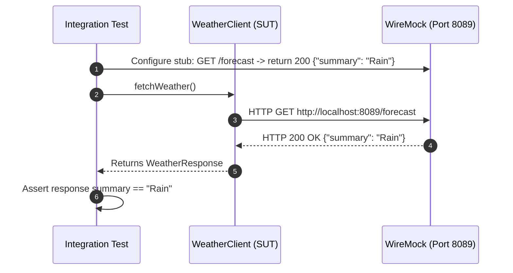

#### WireMock Integration Test Code (`WeatherClientIntegrationTest.java`)

```java
@RunWith(SpringRunner.class)
@SpringBootTest
public class WeatherClientIntegrationTest {

    @Autowired
    private WeatherClient subject;

    @Rule
    public WireMockRule wireMockRule = new WireMockRule(8089);

    @Test
    public void shouldCallWeatherService() throws Exception {
        // Arrange: Train WireMock with pre-canned HTTP response
        wireMockRule.stubFor(get(urlPathEqualTo("/some-test-api-key/53.5511,9.9937"))
                .willReturn(aResponse()
                        .withBody(FileLoader.read("classpath:weatherTestData.json"))
                        .withHeader(CONTENT_TYPE, MediaType.APPLICATION_JSON_VALUE)
                        .withStatus(200)));

        // Act: Execute real HTTP client request against localhost:8089
        Optional<WeatherResponse> weatherResponse = subject.fetch();

        // Assert: Verify parsing and client resilience
        assertThat(weatherResponse.isPresent(), is(true));
        assertThat(weatherResponse.get().getSummary(), is("Rain"));
    }
}
```

---

## 6. Contract Tests: Consumer-Driven Contracts (CDC)

In modern microservice architectures, systems are decomposed into loosely coupled services developed by separate teams. Services communicate via interfaces (REST/JSON, gRPC, or message queues).

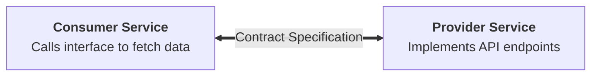

### The Fallacy of "Over-the-Fence" Interface Specifications
The traditional approach to cross-team integration fails predictably:
1. Team A authors a long word document / OpenAPI spec.
2. Team A implements the provider service.
3. Team A "throws the spec over the fence" to Team B.
4. Team B implements their consumer code weeks later.
5. Teams run massive, high-friction end-to-end tests across staging environments.
6. The interface inevitably drifts, causing production outages.

### Consumer-Driven Contract (CDC) Testing

**Consumer-Driven Contract (CDC)** testing inverts this dynamic. The consumers define their exact requirements as automated test suites. These expectations are published as a machine-readable **Contract (Pact file)**. The provider continuously downloads and executes this contract against its API.

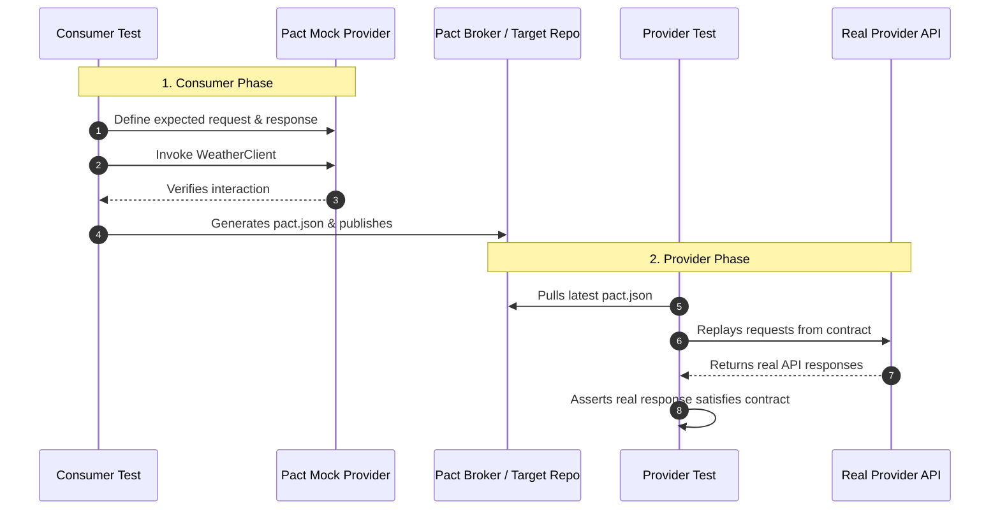

### Benefits of CDC
- **YAGNI Compliance:** Providers only implement and maintain fields that consumers actually use.
- **Immediate Breaking-Change Detection:** If a provider team changes a field name or response structure, the CDC provider test breaks immediately in the provider's CI pipeline before deployment.
- **Elimination of Staging Gridlock:** Teams deploy independently without requiring synchronized end-to-end integration environments.

---

### Consumer Test Execution & Pact File Generation

#### Consumer Test (`WeatherClientConsumerTest.java`)

```java
@RunWith(SpringRunner.class)
@SpringBootTest
public class WeatherClientConsumerTest {

    @Autowired
    private WeatherClient weatherClient;

    @Rule
    public PactProviderRuleMk2 weatherProvider =
            new PactProviderRuleMk2("weather_provider", "localhost", 8089, this);

    @Pact(consumer = "sample_cli")
    public RequestResponsePact createPact(PactDslWithProvider builder) {
        Map<String, String> headers = new HashMap<>();
        headers.put("Content-Type", "application/json");

        return builder
                .given("weather forecast data exists")
                .uponReceiving("a request for weather forecast")
                .path("/some-test-api-key/53.5511,9.9937")
                .method("GET")
                .willRespondWith()
                .status(200)
                .headers(headers)
                .body(FileLoader.read("classpath:weatherTestData.json"))
                .toPact();
    }

    @Test
    @PactVerification("weather_provider")
    public void shouldFetchWeatherInformation() throws Exception {
        Optional<WeatherResponse> weatherResponse = weatherClient.fetch();
        assertThat(weatherResponse.isPresent(), is(true));
        assertThat(weatherResponse.get().getSummary(), is("Rain"));
    }
}
```

Running this test produces a `sample_cli-weather_provider.json` contract file capturing the exact HTTP interaction.

---

### Provider Verification Execution

The provider team takes the generated contract file and executes it against their controller:

```java
@RunWith(RestPactRunner.class)
@Provider("person_provider")
@PactFolder("target/pacts")
public class ExampleProviderTest {

    @Mock
    private PersonRepository personRepository;

    @InjectMocks
    private ExampleController exampleController = new ExampleController(personRepository);

    @TestTarget
    public final MockMvcTarget target = new MockMvcTarget();

    @Before
    public void setUp() {
        initMocks(this);
        target.setControllers(exampleController);
    }

    @State("person data exists")
    public void personDataExists() {
        Person peterPan = new Person("Peter", "Pan");
        given(personRepository.findByLastName("Pan"))
            .willReturn(Optional.of(peterPan));
    }
}
```

---

## 7. UI Tests: Separating Behavior, Layout, and Usability

Most applications provide a user interface: web applications, mobile apps, or command line interfaces (CLIs). UI testing involves three distinct concerns:

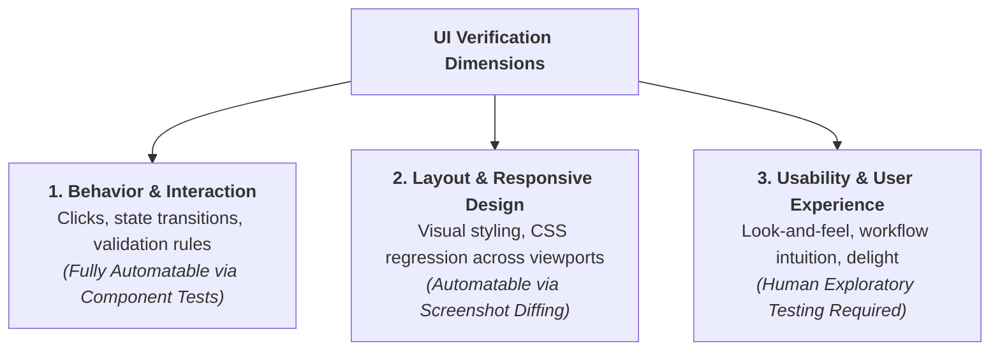

### Component-Level UI Tests
Modern Single Page Application (SPA) frameworks (React, Vue, Angular) enable low-level component tests. Using tools like Jest and Testing Library, developers mount isolated UI components in a virtual DOM, simulate clicks and keyboard input, and verify UI state changes without launching a live browser or hitting a real backend.

### Visual Regression & Layout Testing
Computers cannot inherently evaluate whether an interface "looks good," but they excel at pixel-diff comparisons. Tools like Galen, Percy, and Playwright screenshot runners open pages in multiple viewport dimensions, take snapshots, and flag pixel deviations against an approved baseline.

---

## 8. End-to-End Tests: The Broad Stack Safety Net

End-to-End (E2E) tests—also called **Broad Stack Tests**—run against a fully deployed, integrated system. They simulate authentic user journeys from the frontend interface down to persistent storage.

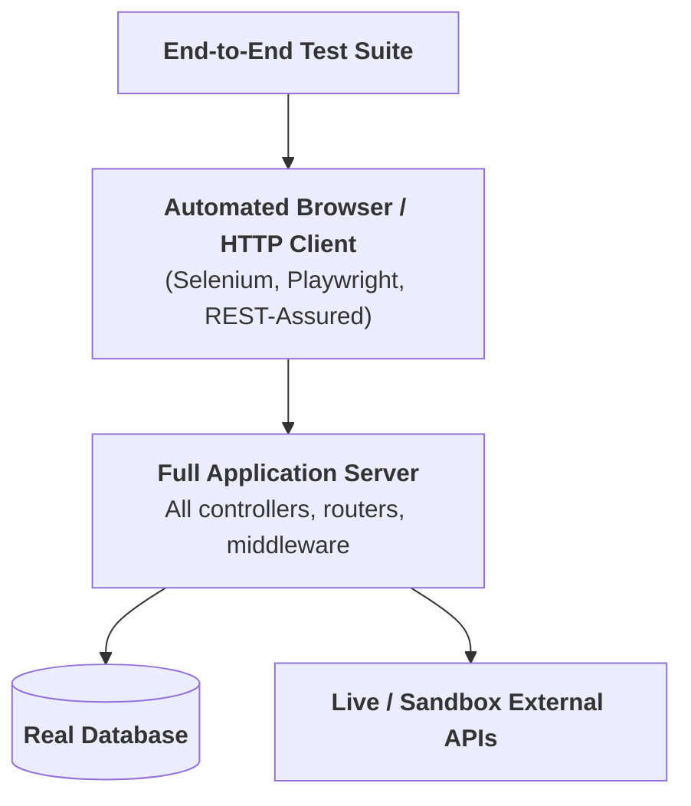

### UI-Driven End-to-End Tests
Tools like Selenium WebDriver or Playwright drive real browsers (Chrome, Firefox, Safari) through end-to-end workflows: loading pages, clicking buttons, waiting for asynchronous network responses, and inspecting rendered DOM text.

#### Selenium E2E Test Example (`HelloE2ESeleniumTest.java`)

```java
@RunWith(SpringRunner.class)
@SpringBootTest(webEnvironment = SpringBootTest.WebEnvironment.RANDOM_PORT)
public class HelloE2ESeleniumTest {

    private WebDriver driver;

    @LocalServerPort
    private int port;

    @BeforeClass
    public static void setUpClass() {
        ChromeDriverManager.getInstance().setup();
    }

    @Before
    public void setUp() {
        DesiredCapabilities capabilities = DesiredCapabilities.chrome();
        capabilities.setCapability("marionette", true);
        driver = new ChromeDriver(capabilities);
    }

    @After
    public void tearDown() {
        if (driver != null) {
            driver.quit();
        }
    }

    @Test
    public void shouldSayHello() throws Exception {
        driver.get(String.format("http://127.0.0.1:%s/hello/Pan", port));
        assertThat(driver.findElement(By.tagName("body")).getText(),
                containsString("Hello Peter Pan!"));
    }
}
```

### REST API-Driven End-to-End Tests
For headless applications or backend microservices, the REST API *is* the primary interface. REST API E2E tests send real HTTP requests over the network against a running application instance and assert response status codes and JSON payloads using libraries such as **REST-Assured**:

```java
@RunWith(SpringRunner.class)
@SpringBootTest(webEnvironment = SpringBootTest.WebEnvironment.RANDOM_PORT)
public class HelloE2ERestTest {

    @Autowired
    private PersonRepository personRepository;

    @LocalServerPort
    private int port;

    @After
    public void tearDown() throws Exception {
        personRepository.deleteAll();
    }

    @Test
    public void shouldReturnGreeting() throws Exception {
        Person peter = new Person("Peter", "Pan");
        personRepository.save(peter);

        when()
                .get(String.format("http://localhost:%s/hello/Pan", port))
        .then()
                .statusCode(is(200))
                .body(containsString("Hello Peter Pan!"));
    }
}
```

### The True Cost and Flakiness of E2E Suites

While E2E tests provide the highest confidence that a release works, they carry severe operational liabilities:
- **Extreme Execution Latency:** Starting browsers, waiting for DOM re-renders, and making multi-hop network calls takes seconds to minutes per test.
- **Flakiness:** Minor network jitters, race conditions in UI animations, and third-party API outages cause false-positive test failures.
- **High Maintenance Overhead:** Small UI restructurings break CSS selectors across dozens of E2E tests.

> **Golden Rule of E2E Testing:** Keep end-to-end tests to an absolute minimum. Use them only to verify critical "golden user journeys" (e.g., login, checkout, core payment flow). Push all combinatorial logic, validation edge cases, and error handling down to unit and narrow integration tests.

---

## 9. Acceptance Tests & Living Documentation

As testing moves up the pyramid, tests shift from technical implementation validation to business intent verification. **Acceptance Tests** ask: *"Does the software do what the user actually needs?"*

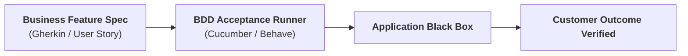

Acceptance tests are frequently expressed in **Given-When-Then** syntax:

```python
# Sample Acceptance Test in Python / Pytest-BDD
def test_add_to_basket():
    # Given
    user = a_user_with_empty_basket()
    user.login()
    bicycle = article(name="bicycle", price=100)

    # When
    article_page.add_to_basket(bicycle)

    # Then
    assert bicycle in user.shopping_basket.items()
```

When written in clear, domain-specific language, acceptance tests serve as **Living Documentation**: executable specifications that reflect the current state of business rules without falling out of date.

---

## 10. Exploratory Testing: Complementing Automation

Even the most diligent automated test suite cannot detect all software defects. Automated tests only verify scenarios that engineers specifically anticipated and scripted.

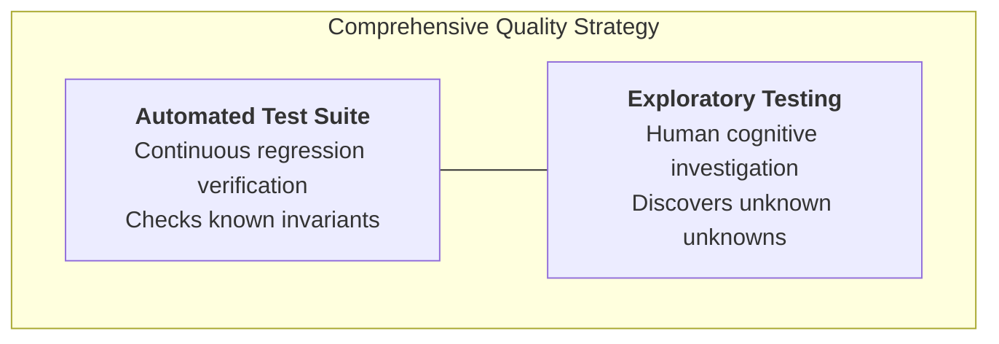

### Role of the Exploratory Tester
Exploratory testing is an active, investigative approach where testers treat software with structured curiosity:
- **Edge-Case Hunting:** What happens if a user opens four tabs simultaneously, alters the URL query params, and presses the back button during a transaction?
- **Usability & Friction Evaluation:** Does the workflow feel intuitive? Are error messages helpful and actionable?
- **Visual Glitches & Layout Defects:** Do UI elements overlap under non-standard screen aspect ratios?

Include exploratory testing in your release process via timeboxed testing charters. Exploratory findings should immediately feed back into the automation pipeline as new regression tests.

---

## 11. Demystifying Testing Terminology

Testing literature is rife with conflicting, overloaded terminology. Different engineers use terms like *component test*, *service test*, *subsystem test*, and *functional test* to mean contradictory things.

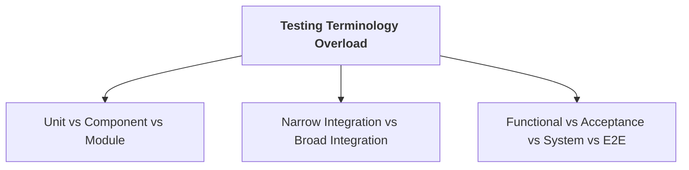

### The Three Operational Dimensions
Instead of debating semantic labels, classify tests along three objective technical dimensions:

1. **Execution Speed:** Milliseconds (Fast) vs. Seconds (Medium) vs. Minutes (Slow).
2. **Scope of SUT:** Single function/class vs. Single service boundary vs. Full integrated multi-service stack.
3. **Collaborator Isolation:** In-memory test doubles vs. In-process stubs (WireMock) vs. Real deployed network dependencies.

---

## 12. Pipeline Integration: Speed and Scope as Organizing Principles

In a Continuous Delivery pipeline, stages must be ordered strictly by **Execution Speed and Scope**, rather than arbitrary formal classifications:

```mermaid
flowchart LR
    subgraph Stage1["Stage 1: Fast Feedback (< 5 min)"]
        direction TB
        S1_1["Compile & Lint"]
        S1_2["Solitary & Sociable Unit Tests"]
        S1_3["Fast Narrow Integration Tests (In-Memory DB)"]
    end

    subgraph Stage2["Stage 2: Acceptance & Contracts (< 15 min)"]
        direction TB
        S2_1["WireMock Integration Tests"]
        S2_2["Pact Consumer & Provider Tests"]
        S2_3["Isolated UI Component Tests"]
    end

    subgraph Stage3["Stage 3: Broad Stack (< 30 min)"]
        direction TB
        S3_1["Smoke E2E Tests (REST Assured)"]
        S3_2["Minimal Critical Browser E2E Journeys"]
        S3_3["Visual Regression Diffs"]
    end

    Stage1 --> Stage2 --> Stage3
```

- **Fail-Fast Principle:** If a developer breaks a simple unit invariant, feedback must arrive within seconds—not 45 minutes later after an E2E cluster spins up.
- **Pragmatic Stage Inclusion:** Fast-running integration tests (e.g. testing an in-memory repository) belong in Stage 1 alongside unit tests because their execution duration is negligible.

---

## 13. Avoiding Test Duplication: Pruning the Iceberg

### The Iceberg Anti-Pattern (The Inverted Pyramid)
When teams neglect unit testing, they often fall into the **Iceberg** (or Inverted Pyramid / Software Testing Hourglass) anti-pattern:

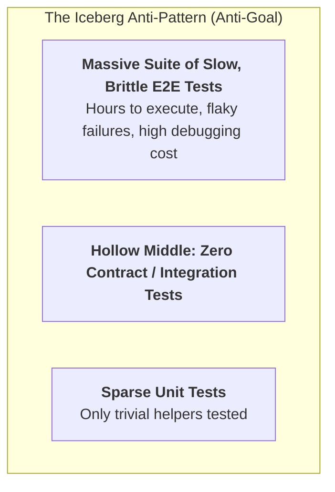

### The Two Golden Rules of Pyramid Hygiene

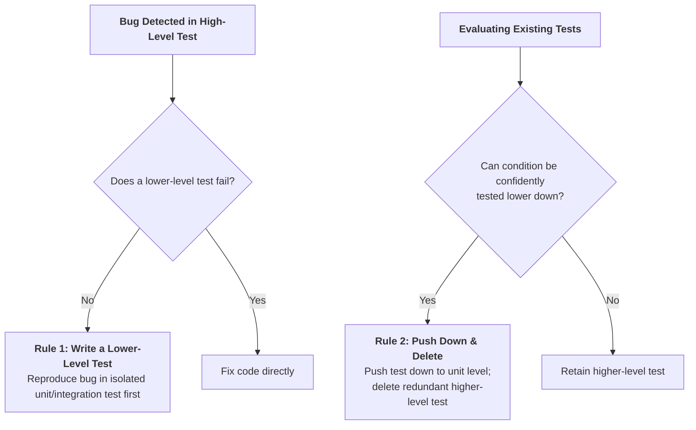

1. **Rule 1: If a higher-level test detects an error and no lower-level test fails, write a lower-level test.** Lower-level tests reproduce issues faster, run in isolation, and protect against future regressions without slowing down CI.
2. **Rule 2: Push your tests as far down the test pyramid as possible.** If a unit test already covers all permutations of a boundary condition, delete the equivalent test from the E2E suite.

> **Beware the Sunk Cost Fallacy:** Writing a complex browser test may have taken two days of hard work. However, if that test is slow, flaky, and duplicates coverage already guaranteed by unit tests, delete it immediately. Maintaining low-value tests wastes engineering time.

---

## 14. Writing Clean Test Code

Test code is production code. It must be written, reviewed, and maintained with the same architectural rigor applied to customer-facing business logic:

1. **Test One Condition Per Test:** Short, focused test cases clearly identify the root cause of failures.
2. **Follow AAA / Given-When-Then:** Clear separation of setup, execution, and verification ensures immediate readability.
3. **Balance DRY and DAMP:** While production code avoids duplication (**Don't Repeat Yourself**), test code prioritizes readability and clarity (**Descriptive And Meaningful Phrases**). Some duplication in test setup is acceptable if it keeps the test case self-contained and obvious.
4. **Use Test Data Builders:** Avoid scattering large, multi-parameter constructors across tests. Use the Test Data Builder pattern with sensible defaults:
   ```typescript
   const message = new MessageBuilder()
     .withThread("orders")
     .withBody("Payment processed")
     .build();
   ```
5. **The Rule of Three:** Do not prematurely abstract test utilities. Duplicate test setup twice; abstract into a shared helper only upon the third occurrence.

---

## 15. Direct Mapping to Chat Bridge Architecture

To enforce the Practical Test Pyramid within **Chat Bridge**, our testing infrastructure maps directly to the repository topology defined in [ADR 0015](decisions/0015-monorepo-topology-workspace-boundaries-contract-guards.md) and [ADR 0018](decisions/0018-testing-harness-scenario-contract-runner.md):

```mermaid
flowchart TD
    subgraph ChatBridgePyramid["Chat Bridge Testing Architecture"]
        E2E_CB["<b>End-to-End Suite (Playwright)</b><br/>Electron desktop app launch, onboarding flow, synthetic outbox replay"]
        UI_CB["<b>UI Component Tests (Vitest + Testing Library)</b><br/>Chat Picker component, Filter inputs, Settings dialogs in isolation"]
        CDC_CB["<b>Contract Tests (Contract Runners)</b><br/>describeSourceContract (Lifecycle, Status, Churn)<br/>describeSinkContract (Delivery, Backoff, Health)<br/>Mock Margince Server (HMAC-SHA256, Nonce, Timestamp)"]
        INT_CB["<b>Narrow Integration Tests (Vitest + In-Memory SQLite)</b><br/>Outbox WAL journal, SQLCipher encryption, Baileys/zca socket stubs"]
        UNIT_CB["<b>Unit Tests (Vitest)</b><br/>Normalization pipeline, Noise filters, Plain-language guards, Domain types"]
    end
    E2E_CB --> UI_CB --> CDC_CB --> INT_CB --> UNIT_CB
```

### Chat Bridge Implementation Mapping

| Pyramid Tier | Chat Bridge Target Packages | Primary Tools & Techniques | Architectural Guard |
| :--- | :--- | :--- | :--- |
| **Unit Tests** | `packages/types`, `packages/engine` | Vitest, Fast In-Memory execution (< 1 ms per test) | Zero I/O; deterministic seeds; pure normalization rules |
| **Narrow Integration** | `packages/engine` (Outbox SQLite) | Vitest, SQLCipher with in-memory DB (`:memory:`) | WAL durability check; transaction rollbacks; secret encryption |
| **Contract Tests (CDC)** | `packages/sources/*`, `packages/sinks/*` | `describeSourceContract`, `describeSinkContract`, Mock Margince server | Source/Sink contracts strictly verified; HMAC signature validation |
| **UI Component Tests** | `packages/ui` | Vitest, React Testing Library, Mocked IPC bridge | Isolated state changes; zero backend dependency |
| **Broad E2E Tests** | `apps/desktop` | Playwright Electron test runner | Minimal smoke verification: launch app, tick 1 chat, verify delivery |
| **Exploratory Testing** | Full Electron bundle | Manual bug charters, network disconnection chaos | Disconnect Wi-Fi during WhatsApp sync; assert WAL recovery |

---

## 16. Acknowledgements & Source References

- **Author:** Ham Vocke (Thoughtworks)
- **Reviewers & Contributors:** Clare Sudbery, Chris Ford, Martha Rohte, Andrew Jones-Weiss, David Swallow, Aiko Klostermann, Bastian Stein, Sebastian Roidl, Birgitta Böckeler, and Martin Fowler.
- **Seminal Works Cited:**
  - Mike Cohn, *Succeeding with Agile: Software Development Using Scrum* (Addison-Wesley, 2009).
  - Jay Fields, *Working Effectively with Unit Tests* (Leanpub, 2014).
  - Gerard Meszaros, *xUnit Test Patterns: Refactoring Test Code* (Addison-Wesley, 2007).
  - Martin Fowler, *Refactoring: Improving the Design of Existing Code* (Addison-Wesley, 1999).
  - Eric Evans, *Domain-Driven Design: Tackling Complexity in the Heart of Software* (Addison-Wesley, 2003).

