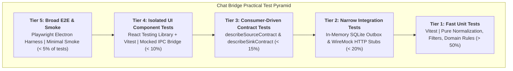
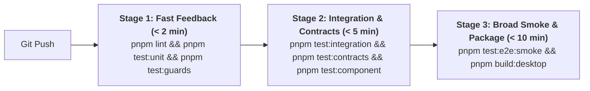

# Chat Bridge: Test Pyramid & Multi-Tier Harness Setup Checklist

**Document Version:** 1.0  
**Target Milestone:** Sprint 0 / Harness Engineering Foundation  
**Primary Persona:** Dylan (Software Engineer / Intern)  
**Theoretical Reference:** [`docs/practical-test-pyramid.md`](practical-test-pyramid.md) (*Ham Vocke / Martin Fowler*)  
**Dynamic Skill Reference:** [`.agents/skills/practical-test-pyramid/SKILL.md`](../.agents/skills/practical-test-pyramid/SKILL.md)  
**Related ADRs:** [ADR 0015](decisions/0015-monorepo-topology-workspace-boundaries-contract-guards.md), [ADR 0018](decisions/0018-testing-harness-scenario-contract-runner.md), [ADR 0008](decisions/0008-margince-push-protocol-hmac-mock.md)

---

## Executive Summary

Applying Ham Vocke's **Practical Test Pyramid** to Chat Bridge requires establishing an inverted cost-to-volume ratio across the monorepo workspace. We must systematically construct each layer of the testing harness before developing feature code:



### Performance & Latency Targets

| Tier | Scope | Target Test Count | Max Run Time | Failure SLA |
| :--- | :--- | :--- | :--- | :--- |
| **Tier 1: Unit** | Pure domain, normalization, filters | > 200 tests | < 2 seconds | Immediate (pre-commit / in-IDE) |
| **Tier 2: Narrow Integration** | SQLite Outbox WAL, SQLCipher encryption | ~50 tests | < 5 seconds | Commit stage CI (< 1 min) |
| **Tier 3: Contract (CDC)** | Source & Sink lifecycle, Margince HMAC | ~40 tests | < 8 seconds | Commit stage CI (< 2 min) |
| **Tier 4: UI Components** | Chat Picker, filters, settings modals | ~30 tests | < 10 seconds | Acceptance stage CI (< 3 min) |
| **Tier 5: E2E Smoke** | Electron launch, WhatsApp fake replay | < 5 tests | < 45 seconds | Pre-merge staging CI (< 5 min) |

---

## Phase 1: Toolchain & Fast Unit Test Scaffolding (Tier 1)

Unit tests form the broad foundation of the Chat Bridge test suite. They run in-memory, have zero disk or network I/O, and execute in milliseconds.

### Tasks & Action Items
- [ ] **1.1 Vitest Root Configuration:**
  - Create `vitest.config.ts` at the monorepo root with project reference support and v8 coverage provider.
  - Configure isolated test environments with pool threading:
    ```typescript
    import { defineConfig } from 'vitest/config';

    export default defineConfig({
      test: {
        globals: true,
        environment: 'node',
        reporters: ['default'],
        coverage: {
          provider: 'v8',
          reporter: ['text', 'json', 'html'],
          thresholds: {
            lines: 90,
            functions: 90,
            branches: 85,
            statements: 90,
          },
        },
      },
    });
    ```
- [ ] **1.2 Domain Test Data Builders:**
  - Implement `MessageBuilder` and `ChatThreadBuilder` in `packages/testing/src/builders/` to support DAMP test authoring without constructor boilerplate.
- [ ] **1.3 Normalization Pipeline Unit Tests:**
  - Author sociable unit tests in `packages/engine/test/normalize.spec.ts` verifying that raw messages normalize into the unified `Message` interface.
- [ ] **1.4 Noise Filter Unit Tests:**
  - Author unit tests for dropped noise: reactions, typing indicators, stories, newsletter broadcasts, and edit events.
- [ ] **1.5 Plain-Language Guard:**
  - Implement AST linter `guards/plain-language.ts` to ensure user-facing UI and error messages never include banned technical jargon (`sink`, `outbox`, `JID`, `regex`).

### Verification Command
```bash
pnpm --filter "@chat-bridge/engine" test:unit
```

---

## Phase 2: Narrow Integration Harness (Tier 2)

Narrow integration tests verify persistence and boundary adapters in isolation. One external subsystem is exercised at a time.

### Tasks & Action Items
- [ ] **2.1 In-Memory SQLite Outbox Harness:**
  - Configure `better-sqlite3` / `sqlcipher` in `packages/engine/test/outbox-harness.ts` using in-memory databases (`:memory:`).
  - Verify that each test runs in an isolated database instance with automatic cleanup on `afterEach()`.
- [ ] **2.2 WAL Journal & Transaction Rollback Verification:**
  - Test ACID transactions: ensure partial batch failures roll back completely without queue corruption.
  - Verify independent queue isolation: failure in Google Sheets sink queue does not block Margince sink queue.
- [ ] **2.3 SQLCipher Encryption Integration:**
  - Verify that outbox message payloads and tokens are encrypted at rest using AES-256-GCM.
- [ ] **2.4 WireMock / MSW HTTP Integration:**
  - Configure Mock Service Worker (MSW) or in-process mock server in `packages/sinks/margince/test/http.spec.ts` to test HTTP network timeouts and 5xx backoff handling.

### Verification Command
```bash
pnpm --filter "@chat-bridge/engine" test:integration
```

---

## Phase 3: Consumer-Driven Contract (CDC) Harness (Tier 3)

Contract tests guarantee that Sources and Sinks comply with engine contracts without requiring live WhatsApp or Zalo sessions.

### Tasks & Action Items
- [ ] **3.1 Source Contract Runner (`describeSourceContract`):**
  - Create reusable test suite in `packages/testing/src/contracts/describeSourceContract.ts` executing:
    - Lifecycle states: `login()`, `start()`, `stop()`, `status()`.
    - Message streaming: `start(onMessage)` emits normalized messages.
    - Historical fetch: `history(since)` pagination and ordering.
    - Bidirectional reply: `send(thread, text)`.
- [ ] **3.2 Sink Contract Runner (`describeSinkContract`):**
  - Create reusable test suite in `packages/testing/src/contracts/describeSinkContract.ts` executing:
    - Configuration and credentials: `configure(settings)`.
    - Connectivity handshake: `test()`.
    - Batch delivery & idempotency: `deliver(batch)`.
    - Exponential backoff & health check: `health()`.
    - Reply polling and delivery receipts: `pullReplies(max)`, `ack(results)`.
- [ ] **3.3 Mock Margince Server Implementation:**
  - Implement standalone test server in `packages/testing/src/mocks/mock-margince-server.ts`.
  - Validate HMAC-SHA256 signature calculation, nonce uniqueness, and replay timestamp windows.
- [ ] **3.4 Source & Sink Conformance Validation:**
  - Run `FakeSource`, `ArchiveSink`, `LocalDatabaseSink`, and `MarginceSink` through the contract runners.

### Verification Command
```bash
pnpm --filter "@chat-bridge/testing" test:contracts
```

---

## Phase 4: Isolated UI Component Tests (Tier 4)

UI component tests verify user interface behavior in isolation without launching a full Electron process or talking to real backend sinks.

### Tasks & Action Items
- [ ] **4.1 React Testing Library & Vitest Environment:**
  - Configure `happy-dom` or `jsdom` in `packages/ui/vitest.config.ts`.
- [ ] **4.2 Mock Electron IPC Bridge:**
  - Implement type-safe mock for `window.electronAPI` to simulate chat listings and toggle state changes.
- [ ] **4.3 Chat Picker Component Tests:**
  - Test that ticking a chat includes its thread ID in the export set.
  - Test that unticking a chat immediately halts message flow.
  - Test search and filtering UI responsiveness.
- [ ] **4.4 Plain-Language Error Dialog Verification:**
  - Test that connection errors render plain-English resolution steps (e.g. *"Check your internet connection and click Retry"*).

### Verification Command
```bash
pnpm --filter "@chat-bridge/ui" test:component
```

---

## Phase 5: Broad End-to-End Smoke Suite (Tier 5)

End-to-End tests verify the entire integrated application. To prevent the **Iceberg Anti-Pattern**, limit this suite to a minimal set of golden journeys.

### Tasks & Action Items
- [ ] **5.1 Playwright Electron Runner:**
  - Configure Playwright in `apps/desktop/playwright.config.ts` to launch the packaged Electron binary with synthetic flags.
- [ ] **5.2 Golden Journey 1: First-Run Onboarding & Fake Replay:**
  - Launch app -> Select `Fake` source -> Tick test chat -> Select `Archive` sink -> Verify JSONL file written to disk.
- [ ] **5.3 Golden Journey 2: Offline Resilience & Reconnect:**
  - Disconnect network stub -> Queue 10 messages -> Reconnect network -> Assert all 10 messages delivered with zero loss.
- [ ] **5.4 Anti-Duplication Pruning Audit:**
  - Ensure no fine-grained regex or filter permutation tests exist in the Playwright suite; confirm all edge cases are verified at Tier 1.

### Verification Command
```bash
pnpm --filter "@chat-bridge/desktop" test:e2e:smoke
```

---

## Phase 6: Continuous Integration & Anti-Duplication Gates

Order the CI/CD pipeline strictly by **Speed and Scope** to provide immediate feedback:



### Tasks & Action Items
- [ ] **6.1 Pre-Commit Git Hook:**
  - Set up `lint-staged` and `simple-git-hooks` to run `guards/*.ts` and unit tests on staged files (< 5 seconds).
- [ ] **6.2 GitHub Actions Pipeline Scaffolding:**
  - Create `.github/workflows/ci.yml` with fail-fast parallel jobs for Stage 1, Stage 2, and Stage 3.
- [ ] **6.3 AST Boundary Linter:**
  - Run `guards/contract-boundary.ts` to guarantee that Sources and Sinks never import each other directly or bypass the Engine.
- [ ] **6.4 Knip Unused Export & Test Code Audit:**
  - Execute `pnpm knip` to prevent dead test helpers and unasserted test fixtures from accumulating.

### Master Verification Command
```bash
pnpm test:all
```

---

## Handoff & Definition of Done

The Test Pyramid harness setup is complete when:
1. `pnpm test:unit` runs > 200 tests in under 2 seconds.
2. `describeSourceContract` and `describeSinkContract` pass for all Phase 1 adapters.
3. No user-facing text contains forbidden internal jargon (`guards/plain-language.ts` passes).
4. CI pipeline completes all stages in under 10 minutes with zero flakiness.
5. All tests follow the **Arrange-Act-Assert** / **Given-When-Then** format and utilize Test Data Builders.

