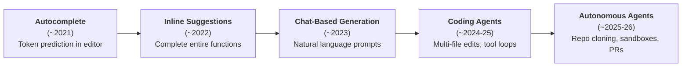
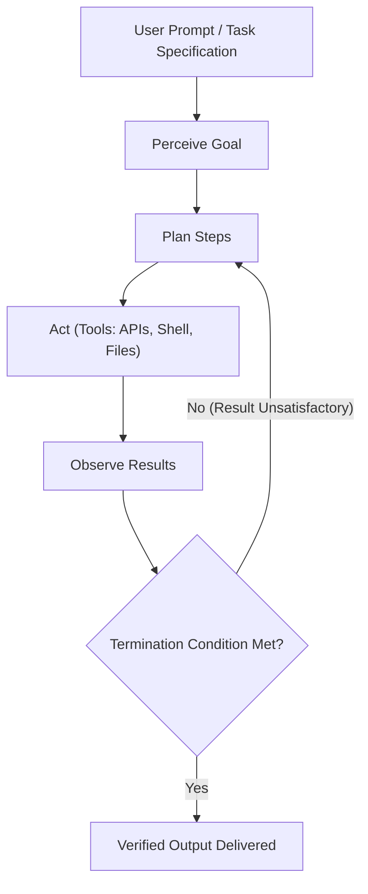
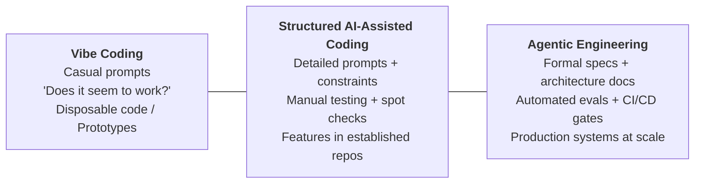
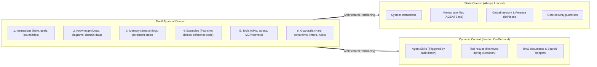
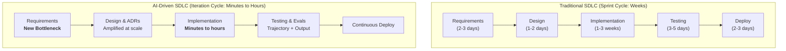
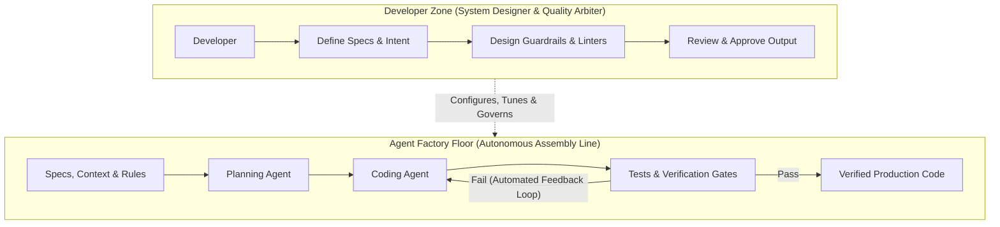
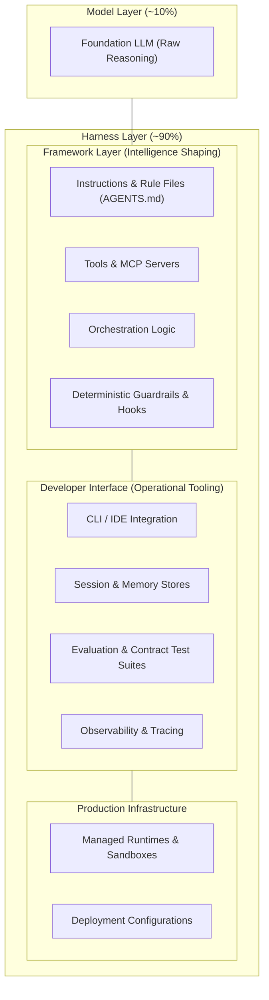
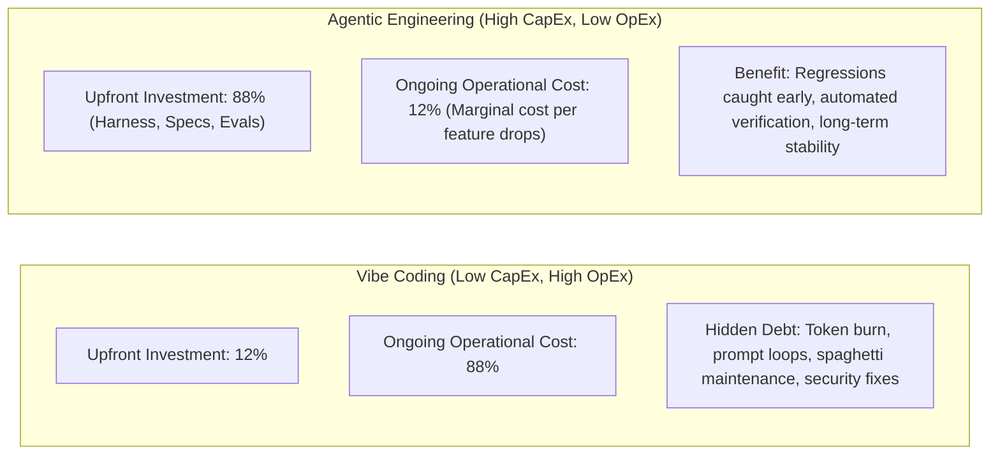
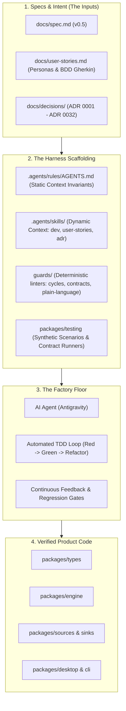

# The New SDLC With Vibe Coding: From Ad-Hoc Prompting to Agentic Engineering

**Authors:** Addy Osmani, Shubham Saboo, and Sokratis Kartakis (Google)  
**Publication Date:** May 2026  
**Source Document:** `SDLC.pdf`  
**Curators & Editors:** Anant Nawalgaria | **Contributors:** Elia Secchi, Julia Wiesinger, Anant Nawalgaria | **Designer:** Michael Lanning  
**Project Application:** Reference framework for AI pair-programming, harness engineering, and backlog governance in Chat Bridge.

---

## Quick Reference: Core Mental Models & Formulas

| Concept | Definition / Formula | Key Architectural Rule |
| :--- | :--- | :--- |
| **The Core Equation** | `Agent = Model + Harness` | The model is ~10% (raw reasoning engine); the harness is ~90% (prompts, tools, sandboxes, hooks, evals). Changing harness alone elevates benchmarks by double digits. |
| **The Factory Model** | *Developer designs the system that builds software.* | The developer's primary output is not code: it is the specifications, harness, tests, and guardrails that produce and verify code. |
| **Context Engineering** | Static Context vs. Dynamic Context | **Static** (always loaded: `AGENTS.md`, core rules) = high token cost, zero forgetting.<br/>**Dynamic** (loaded on-demand: Skills, RAG, tool output) = low token cost, high scale. |
| **The Spectrum** | Vibe Coding $\leftrightarrow$ Agentic Engineering | Differentiated not by AI usage, but by **how outputs are verified** (vibe: *"does it seem to work?"*; agentic: automated tests + evals + CI/CD gates). |
| **Developer Modes** | Conductor vs. Orchestrator | **Conductor:** Synchronous, in-IDE, keystroke/file level.<br/>**Orchestrator:** Asynchronous, multi-agent, goal/repo level, reviews outcomes not keystrokes. |
| **The 80% Problem** | Agents generate 80% quickly; the remaining 20% requires deep human context. | Human expertise must focus on edge cases, architectural trade-offs, and verification rather than syntax boilerplate. |
| **AI Economics** | CapEx vs. OpEx Inversion | **Vibe Coding:** Low CapEx, High OpEx (token burn, context collapse, maintenance tax).<br/>**Agentic Engineering:** High CapEx (schemas, evals, harness), Low OpEx (sustainable scale, low marginal feature cost). |

---

## Table of Contents

1. [Introduction: The Shift from Syntax to Intent](#1-introduction-the-shift-from-syntax-to-intent)
2. [AI Agents: A Quick Refresher](#2-ai-agents-a-quick-refresher)
3. [What is Vibe Coding? The Spectrum from Vibe Coding to Agentic Engineering](#3-what-is-vibe-coding-the-spectrum-from-vibe-coding-to-agentic-engineering)
4. [Context Engineering: The Real Skill](#4-context-engineering-the-real-skill)
5. [The New Software Development Life Cycle (SDLC)](#5-the-new-software-development-life-cycle-sdlc)
6. [The Factory Model: Building the System that Builds Software](#6-the-factory-model-building-the-system-that-builds-software)
7. [Harness Engineering: What Surrounds the Model](#7-harness-engineering-what-surrounds-the-model)
8. [The Developer's Evolving Role: Conductors and Orchestrators](#8-the-developers-evolving-role-conductors-and-orchestrators)
9. [Coding Agents in Practice](#9-coding-agents-in-practice)
10. [The Economics of AI Development](#10-the-economics-of-ai-development)
11. [Where to Start: Actionable Guidance](#11-where-to-start-actionable-guidance)
12. [Conclusion: Intent as the New Interface](#12-conclusion-intent-as-the-new-interface)
13. [Endnotes & Citations](#13-endnotes--citations)
14. [Direct Mapping to Chat Bridge Architecture](#14-direct-mapping-to-chat-bridge-architecture)

---

## 1. Introduction: The Shift from Syntax to Intent

> *"The most profound shift in software engineering isn't a new language, framework, or cloud service. It's the transition from writing code to expressing intent, and trusting intelligent systems to translate that intent into working software."*

For most of computing history, programming has been an act of translation: understand the problem in human terms, design a solution in abstract terms, then render it in syntax a machine can execute. Each step introduces friction. That friction is now collapsing.

For decades, the developer's primary interface with the machine has been syntax: curly braces, semicolons, type annotations, and the precise grammar of programming languages. That era is ending.

A new paradigm has arrived in which developers express what they want to build rather than how to build it. The machine handles implementation. The human provides intent, architecture, and judgment. This is the daily reality for professional developers:
* **85%** of professional developers regularly use AI Coding Agents.
* **51%** use them daily.
* **41%** of all new code is AI-generated (early 2026 industry data).

### Evolution: From Autocomplete to Autonomy



* **~2021 (Autocomplete):** Simple token predictions. The editor guesses your next few characters.
* **~2022 (Inline Code Suggestions):** Complete entire functions from a signature. Model understands patterns, not just tokens.
* **~2023 (Chat-Based Generation):** Describe a feature in natural language, receive a working implementation. The conversation becomes the interface.
* **~2024–25 (Coding Agents):** Multi-file edits, tool calling, test execution, iterative self-correction. The agent runs its own loop.
* **~2025–26 (Autonomous Agents):** Clone repositories, plan architecture, execute in sandboxes, run full test suites, submit pull requests without human keystrokes.

---

## 2. AI Agents: A Quick Refresher

An **AI agent** is a software system that perceives a goal, plans steps to reach it, takes actions through tools, observes the results, and iterates until the goal is met or it hits a stopping condition. Where a chatbot produces a response and waits for the next prompt, an agent runs its own loop:



### The 5 Anatomical Components of an Agent

1. **The Model:** The reasoning engine. Reads the current context, decides what should happen next, and produces the next thought, tool call, or message.
2. **Tools:** Connect the model to the world. Include APIs, shell execution, databases, and sub-agents.
3. **Memory:** The state. Allows the agent to recall past interactions, retrieve project-specific rules, and retain context across sessions.
4. **Orchestration:** The code running the loop. Assembles context for each model call, dispatches tools, captures outputs, and determines continuation.
5. **Deployment:** Production substrate: hosting, identity, observability, sandboxing, and security infrastructure.

---

## 3. What is Vibe Coding? The Spectrum from Vibe Coding to Agentic Engineering

In February 2025, Andrej Karpathy coined the term **"vibe coding"**: an approach where you *"fully give in to the vibes, embrace exponentials, and forget that the code even exists."* In this mode, a developer describes what they want in natural language, accepts the AI's output, and when something breaks, copies the error message back into the prompt.

By early 2026, Karpathy and the industry acknowledged that vibe coding is only one end of a continuum. The disciplined counter-weight is **agentic engineering**:



### Spectrum Comparison Matrix

| Dimension | Vibe Coding | Structured AI-Assisted Coding | Agentic Engineering |
| :--- | :--- | :--- | :--- |
| **Intent Specification** | Casual natural language prompts | Detailed prompts with examples and constraints | Formal specifications, architecture decision records (ADRs), memory rules files (`AGENTS.md`) |
| **Verification** | *"Does it seem to work?"* (visual check) | Manual testing, targeted spot-checking | Automated test suites (TDD), CI/CD gates, LM-as-a-judge |
| **Codebase Understanding** | Minimal; developer may not read code | Selective review of critical paths | Comprehensive review of architecture; AI handles implementation details |
| **Error Handling** | Copy-paste error messages back to AI | Developer diagnoses root cause, AI implements fix | Agents self-diagnose within defined bounds; humans handle architectural issues |
| **Appropriate Scope** | Prototypes, disposable scripts, hackathons | Features within established codebases | Mission-critical production systems, team-scale development |
| **Risk Profile** | High; acceptable for disposable code | Moderate; human judgment at key checkpoints | Low; systematic verification at every stage |

> [!IMPORTANT]
> **The Key Differentiator is Verification:** In vibe coding, verification is optional. In agentic engineering, **Tests** verify deterministic behavior (given input $X$, output is $Y$), while **Evaluations (Evals)** verify non-deterministic behavior (did the agent select the right trajectory of tools and satisfy the business rubric?). Without both, the practice remains vibe coding.

---

## 4. Context Engineering: The Real Skill

The quality of AI-generated code depends less on clever prompting and more on **context engineering**: providing AI agents with rich, structured, and bounded information about the codebase, architecture, conventions, and intent.

### The 6 Primary Types of Context



* **Static Context:** Always loaded in every interaction (`AGENTS.md`, system prompt, core invariants). High token cost per turn, but prevents the agent from forgetting foundational rules.
* **Dynamic Context:** Loaded on-demand through **Agent Skills** and tool invocations. Extremely cost-effective; pays token costs only when specialized tasks are active.
* **Agent Skills as Dynamic Context:** Structured, portable packages of procedural knowledge loaded via progressive disclosure (lightweight metadata at startup $\rightarrow$ full instructions on task match $\rightarrow$ deep reference files on explicit need).

---

## 5. The New Software Development Life Cycle (SDLC)

AI does not simply accelerate the existing SDLC; it fundamentally redistributes the bottlenecks:



### Phase Transformations

1. **Requirements & Planning:** Specification quality is the new bottleneck. Ambiguous requirements lead to massive hallucinations. Requirements become interactive conversations producing specifications and test prototypes simultaneously.
2. **Design & Architecture:** Architecture remains stubbornly human-centric because it balances trade-offs (consistency vs. availability, build vs. buy) that AI cannot intuit. However, once documented (e.g. in ADRs), agents excel at executing those patterns consistently across modules.
3. **Implementation:** Implementation compresses from weeks to minutes/hours. The developer's role shifts from writing syntax to reviewing, guiding, and verifying.
4. **Testing & QA:** Testing shifts from manual QA to continuous quality flywheels. Both **Output Evaluation** (did it compile and pass tests?) and **Trajectory Evaluation** (did the agent take a sound reasoning path and avoid dangerous shortcuts?) are required.
5. **Code Review & Deployment:** AI serves as a first-pass reviewer (security vulnerabilities, style, performance), freeing human reviewers to focus on architectural alignment and intent.
6. **Maintenance & Evolution:** Legacy code refactoring, dependency upgrades, and test modernization become continuous background tasks rather than multi-month manual rewrites.

---

## 6. The Factory Model: Building the System that Builds Software

The core thesis of the paper:
> **"In the factory model, the developer's primary output is not code: it's the system that produces code."**

A factory manager does not assemble every widget by hand. They design the assembly line, establish tolerance thresholds, and ensure quality control:



### The 5 Pillars of the Factory System

1. **Specifications & Context:** Formal definitions of what needs to be built.
2. **Agents:** Autonomous reasoning engines that translate specifications into code.
3. **Tests & Quality Gates:** Deterministic assertions and evals verifying correctness.
4. **Feedback Loops:** Automated mechanisms routing failures back to agents for self-correction.
5. **Guardrails:** Hard boundary constraints preventing security leaks, circular dependencies, and jargon violations.

---

## 7. Harness Engineering: What Surrounds the Model

> $$\mathbf{Agent = Model + Harness}$$

A raw foundation model is not an agent. It becomes an agent only when surrounded by a **harness**: the scaffolding that gives it memory, sandboxing, tool access, and enforceable constraints.



### What's in the Harness?

* **Instructions & Rule Files:** `AGENTS.md`, `CLAUDE.md`, skill definitions, and sub-agent system prompts.
* **Tools & MCP Servers:** APIs, terminal execution, filesystem tools, database adapters, and web search.
* **Sandboxes:** Isolated execution environments restricting network access and filesystem write boundaries.
* **Orchestration Logic:** Task decomposition, multi-agent delegation, and model routing.
* **Guardrails & Hooks:** Deterministic scripts executed before tool calls, after file edits, or pre-commit.
* **Observability:** Telemetry, token accounting, latency logging, and agent trajectory auditing.

### Measurable Benchmark Impact of Harness Engineering
* On **Terminal Bench 2.0**, one team moved an agent from outside the Top 30 to the **Top 5** by changing *only the harness*, with zero model changes.
* A LangChain study raised agent benchmark scores by **13.7 points** simply by tuning system prompts, tools, and middleware around a fixed model.
* *Takeaway:* When an agent fails, developers intuitively blame the model. In reality, most agent failures are **harness configuration failures**.

---

## 8. The Developer's Evolving Role: Conductors and Orchestrators

```mermaid
flowchart TD
    subgraph Conductor["Conductor Mode (In-IDE, Synchronous)"]
        direction TB
        C1["Developer prompts -> Agent writes inline -> Developer refines"]
        C2["Tools: Inline completion, chat panels, diff inspection"]
        C3["Characteristics: Keystroke-level, immediate feedback, single-file scope"]
        C4["Best for: Exploratory coding, prototyping, learning new libraries"]
    end

    subgraph Orchestrator["Orchestrator Mode (Multi-Agent, Asynchronous)"]
        direction TB
        O1["Developer sets goal -> Agent executes in sandbox -> Developer reviews PR"]
        O2["Tools: Background terminal agents, CI/CD runners, eval suites"]
        O3["Characteristics: Goal-level, delayed feedback, multi-file/repo scope"]
        O4["Best for: Feature builds, refactorings, test generation, migrations"]
    end
```



### The 80% Problem
* AI agents rapidly generate ~80% of a feature. The remaining **20%** (subtle business edge cases, error recovery, integration boundaries, performance quirks) demands deep contextual understanding.
* High-performing engineers adopt a specific posture: **use AI for what it excels at (rapid generation under clear specs), and reserve human attention for what AI struggles with (architectural trade-offs, security, and verification).**

---

## 9. Coding Agents in Practice

### Everyday Taxonomy
1. **In the Editor:** Inline completions, quick refactoring, codebase Q&A (Cursor, Copilot, Windsurf).
2. **In the Terminal:** Goal-driven multi-file agents with terminal and test access (Antigravity CLI, Claude Code, Codex CLI).
3. **In the Background:** Cloud-hosted asynchronous agents executing multi-hour tasks and submitting pull requests (Google Jules, Copilot agent mode).

### Building Production Agents (Agents CLI)
When building agentic applications (support bots, analysts, automated pipelines):
```bash
# Setup Google Agents CLI
uvx google-agents-cli setup

# Build, evaluate, and deploy via conversational instructions
> Build a support agent that answers questions from our docs.
> evaluate it on the FAQ dataset
> Deploy it to Agent Engine
```
Multi-agent systems coordinate via **Model Context Protocol (MCP)** for tools and the **Agent2Agent (A2A)** protocol for cross-agent delegation.

---

## 10. The Economics of AI Development

Total Cost of Ownership (TCO) flips between vibe coding and agentic engineering:



### Financial Levers
1. **Context Engineering as Financial Optimization:** Passing 100,000 tokens of raw repository files per prompt burns capital. Using dynamic skills and high-signal `AGENTS.md` minimizes token waste.
2. **Intelligent Model Routing:** Route complex architecture and initial generation to frontier reasoning models; route deterministic lower-complexity tasks (test generation, linting, code review) to smaller, faster, cheaper models.

---

## 11. Where to Start: Actionable Guidance

### For Individual Developers
1. **Set up an `AGENTS.md`:** Start with stack conventions, hard rules, and workflows. Add a rule every time the agent makes an unforced error.
2. **Install Agent Skills:** Equip your agent with structured procedural skills (e.g., TDD runbooks, contract runners).
3. **Pick One Repetitive Workflow First:** Automate a single test suite, code review, or research task before building complex multi-agent graphs.
4. **Write Tests and Evals Before Code:** Tests and evals communicate intent more rigorously than any natural-language prompt.
5. **Review Every Line That Ships:** Scrutinize hallucinated imports, boundary leaks, and missing error handlers.
6. **Maintain Foundational Skills:** Keep your architectural taste, debugging instincts, and system design skills sharp.

### For Engineering Leaders
1. **Treat Context Engineering as Production Code:** Version `AGENTS.md`, skills, and eval suites in Git with code reviews.
2. **Set the Bar at the Eval, Not the Demo:** A demo proves an agent worked once; a passing eval suite proves it works reliably.
3. **Re-shape Code Review for AI Code:** Train reviewers to spot insidious conceptual bugs and subtle edge-case omissions.
4. **Explicitly Separate Prototyping from Production:** Vibe coding is for prototypes; agentic engineering is for production.
5. **Invest in Reusable Harness Infrastructure:** Shared skills, MCP connectors, and eval suites compound across projects.

### For Organizations
1. **Treat AI-Assisted Development as an Engineering Investment:** Pair AI tooling with architectural standards and automated linters.
2. **Invest in the Production Substrate Before Scale:** Build CI eval runners, sandboxes, and permission boundaries early.
3. **Adopt Open Standards:** Standardize on Model Context Protocol (MCP) and Agent2Agent (A2A).
4. **Structure Hybrid Teams:** Design explicit human-agent handoff boundaries in PRs and deployments.
5. **Reframe Hiring Around Judgment:** Value engineers who excel at specification, decomposition, system architecture, and verification.

---

## 12. Conclusion: Intent as the New Interface

Three durable principles:
1. **Structure scales, vibes don't.** Vibe coding is great for weekend hacks. Production systems require formal specifications, deterministic tests, guardrails, and human architectural oversight.
2. **AI amplifies your engineering culture.** Teams with strong testing, modular architecture, and rigorous review compound velocity; teams with loose discipline multiply technical debt.
3. **The human role is evolving, not diminishing.** Generation is solved. Verification, judgment, and architectural direction are the new craft.

---

## 13. Endnotes & Citations

1. GetPanto, *"AI Coding Assistant Statistics 2025-2026"* & Index.dev, *"Developer Productivity Statistics with AI Tools"*.
2. Karpathy, A., *"Vibe Coding"*, X/Twitter, Feb 2025; Wikipedia, *"Vibe coding"*.
3. Osmani, A., *"Agentic Engineering"*, [addyosmani.com/blog/agentic-engineering/](https://addyosmani.com/blog/agentic-engineering/).
4. Karpathy, A., *"From Vibe Coding to Agentic Engineering"*, The New Stack, 2026.
5. Glide, *"What is Agentic Engineering?"* & The New Stack, *"Vibe Coding, Agentic Engineering"*.
6. CircleCI, *"AI-Native SDLC"*, [circleci.com/blog/ai-sdlc/](https://circleci.com/blog/ai-sdlc/).
7. GroovyWeb, *"SDLC in the AI Era 2026"* & EPAM, *"From Traditional Software to a Native AI SDLC"*.
8. Osmani, A., *"The Factory Model"*, [addyosmani.com/blog/factory-model/](https://addyosmani.com/blog/factory-model/).
9. Deloitte, *"AI in Software Engineering: Productivity Gains 2025-2026"*.
10. METR, *"Uplift Update: Measuring the Impact of AI Coding Tools"*, Feb 2026.
11. Google, *"Introduction to Agents"*, Agents Whitepaper Series, Nov 2025.
12. Osmani, A., *"From Conductors to Orchestrators: The Future of Agentic Coding"*, [addyosmani.com/blog/future-agentic-coding/](https://addyosmani.com/blog/future-agentic-coding/).
13. Google, *"Jules: AI-Powered Coding Agent"*, Google Developers Blog.
14. Osmani, A., *"The 80% Problem in Agentic Coding"*, [addyo.substack.com](https://addyo.substack.com/p/the-80-problem-in-agentic-coding).
15. Dave Patten, *"The State of AI Coding Agents 2026"*, Medium.
16. Lawfare, *"When the Vibes Are Off: The Security Risks of AI-Generated Code"*.
17. Google, *"Multi-Agent Systems and Design Patterns"*, Agents Whitepaper Series, Nov 2025.
18. Google, *"Agent Development Kit (ADK)"*, [google.github.io/adk-docs/](https://google.github.io/adk-docs/).
19. Google, *"Agent-to-Agent (A2A) Protocol"*, [google.github.io/a2a-protocol/](https://google.github.io/a2a-protocol/).
20. TLDL, *"AI Coding Tools 2026"*, [tldl.io](https://www.tldl.io/resources/ai-coding-tools-2026).
21. Google, *"Gemini Code Assist"*, Google Cloud Docs.
22. Dark Reading, *"Coders Adopt AI Agents, but Security Pitfalls Lurk in 2026"*.
23. Google, *"Gemini CLI"*, [github.com/google-gemini/gemini-cli](https://github.com/google-gemini/gemini-cli).
24. Google, *"Agent Tools: Interoperability with Model Context Protocol (MCP)"*, Nov 2025.
25. Google, *"Agent Quality and Prototype to Production"*, Nov 2025.
26. Lawfare, *"Security Risks of AI-Generated Code"*, 2026.
27. DevOps.com, *"AI-Generated Code Packages Can Lead to Slopsquatting Threat"*.
28. Osmani, A., *"Beyond Vibe Coding"*, O'Reilly Media, 2025-2026.
29. Shubham Saboo, *"Awesome LLM Apps"*, GitHub.
30. Osmani, A., *"My LLM Coding Workflow Going Into 2026"*, [addyosmani.com](https://addyosmani.com/blog/ai-coding-workflow/).
31. Questera, *"7 AI Coding Trends to Watch in 2026"*.
32. Roberto Butti, *"Programming in the Age of AI: From Code to Intent"*, DEV Community.

---

## 14. Direct Mapping to Chat Bridge Architecture

The Chat Bridge codebase is an intentional realization of **The Factory Model** and **Harness Engineering**:



* **The Factory Model in Chat Bridge:** We did not jump straight into raw coding (*vibe coding*). We invested high CapEx upfront in specifications, architectural trade-offs (32 ADRs), persona-grounded user stories, and automated contract runners.
* **Harness Engineering in Chat Bridge:**
  * **Static Context:** `.agents/rules/AGENTS.md` establishes zero-PII rules, no import cycles, and plain-language UX guards.
  * **Dynamic Context:** Agent skills (`chat-bridge-dev`, `architecture-decision`, `user-story-authoring`) are progressively loaded when needed.
  * **Deterministic Hooks & Guards:** AST linters (`guards/contract-boundary.ts`, `guards/no-cycles.ts`, `guards/plain-language.ts`) prevent drift automatically.
  * **Contract Test Runners:** `describeSourceContract` and `describeSinkContract` in `packages/testing` enforce behavioral conformity across mock and real connectors.
* **Execution Checklist:** See [`docs/factory-model-setup.md`](factory-model-setup.md) for Dylan's step-by-step Harness Engineering implementation runbook.
